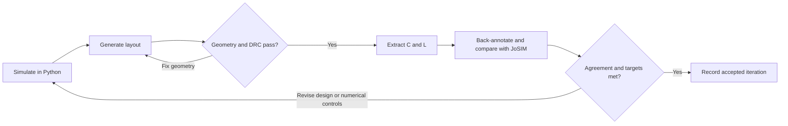

<p align="center">
  
</p>
<h1 align="center">TWPA Sim</h1>
<p align="center">Circuit, gain and quantum-noise models for superconducting parametric amplifiers.</p>
<p align="center">
  <a href="https://github.com/mandalsoumyajit/twpa-sim/actions/workflows/tests.yml"></a>
  &nbsp; Python 3.10+ &nbsp; · &nbsp; MIT License
</p>

TWPA Sim is a Python toolkit for studying **superconducting microwave
parametric amplifiers**. A strong microwave pump transfers energy to a weak
signal through a nonlinear inductance. The simulation predicts the amplified
signal, the generated idler frequency, and the effects of internal loss and
quantum noise. These devices are useful where very small microwave signals
must be measured without adding excessive noise.

The supported physical circuits include kinetic-inductance transmission lines,
Josephson-junction traveling-wave amplifiers, flux-biased junction loops and
resonant Josephson parametric amplifiers. A traveling-wave amplifier builds
gain along a line and is usually measured in transmission; a resonant JPA
stores energy in a nonlinear mode and the examples measure its reflected
signal. The [physical introduction](docs/physical-overview.md) explains those
differences and links each device family to its literature.

Start from an effective resonator when its resonance and damping are already
known, or from a finite circuit when junction dynamics and port reflections
matter. Supported layout extraction derives capacitance and inductance for
back-annotation into a resonant JPA circuit. Optional **JoSIM** simulations
independently compare classical circuit response; quantum noise is checked
through quantum identities and analytic limits. The supplied examples use
illustrative parameters and are not automatically calibrated to a fabricated
device.

**Start here:** [Design cycle](docs/design-workflow.md) ·
[Tools and setup](docs/tools-and-setup.md) ·
[Physical introduction](docs/physical-overview.md) ·
[HOWTO](HOWTO.md) · [Documentation index](docs/README.md)

For reading equations, use the [symbol glossary](docs/symbols.md). For
harmonic balance, numerical refinement, stability and noise diagnostics, use
[Understanding the numerical calculations](docs/numerical-methods.md).

## Follow the design cycle

Start with an electrical model and explicit performance targets. Generate a
candidate layout only after the electrical response is understood. Check its
geometry, extract supported physical parameters, simulate the updated circuit,
and revise if either the numerical comparison or device performance fails.



DRC means design-rule checking; `C` and `L` mean capacitance and inductance.
An electrical study can stop before layout. The complete generated-layout →
field extraction → circuit comparison path currently covers a **single-junction
resonant JPA**. Other device families have the documented electrical models,
candidate layouts/checks and Josephson circuit comparisons, but not equivalent
automatic layout back-annotation. The
[workflow and coverage table](docs/design-workflow.md) explain the inputs,
outputs, checks and revision decisions at every stage. Its
[worked JPA cycle](docs/design-workflow.md#worked-jpa-cycle) gives commands
from the initial circuit to checked layout and back-annotated response.

## Required and optional tools

Optional tools become required when you choose their corresponding stage.
They are not all installed by `pip install -e .`.

| Tool | What it does here | When needed |
| --- | --- | --- |
| Python 3.10+, NumPy, SciPy | Electrical simulation, gain, quantum noise and workflow orchestration | Core requirement; pip installs declared NumPy/SciPy dependencies |
| Matplotlib | Plot results in scripts that offer plots | Optional `.[plot]` extra |
| KLayout Python module | Generate/read GDS; check geometry, connectivity and profile rules | Required for layout and preparing field geometry; `.[layout]` extra |
| KLayout application | View layouts/markers and run the independent native Ruby DRC deck | Separate installation for these additional checks |
| JoSIM | Independently simulate physical Josephson circuits in time | Separate executable for actual circuit comparisons; dry-run netlist generation needs none |
| openEMS + CSXCAD | Solve the supported capacitor geometry and extract capacitance | Separate compiled libraries/Python environment for electric extraction |
| Whiteley superconducting FastHenry | Extract interconnect, return, kinetic and signed mutual inductance | Separate Linux/WSL executable for the magnetic JPA flow |

The [tools guide](docs/tools-and-setup.md) gives installation sources, runtime
checks, environment separation, Windows/WSL requirements and JoSIM capability
requirements. The [layout guide](docs/layout.md) explains the process profiles;
the [extraction guide](docs/magnetic-extraction.md) explains what the field
solvers pass back to the circuit. Tool agreement, clean DRC and useful amplifier
performance are separate checks in the design loop.

## Choose a model

| Device / question | Python interface | What it calculates | Guide |
| --- | --- | --- | --- |
| Kinetic-inductance TWPA / periodic ladder | `Cell`, `Design`, `small_signal`, `nonlinear` | ABCD/Bloch dispersion, 3WM gain, depletion and gradients | [KIT](docs/kit-twpa.md) |
| KIT with dielectric TLS loss | `IDCGeometry`, `oxide_design`, `TLS`, `coupled` | Field participation → lossy propagation → gain and bath noise | [TLS pipeline](docs/kit-twpa.md#tls-loss-and-noise) |
| Kerr-pumped resonant JPA | `jpa` | Stable pump roots, reflection gain, internal-loss noise and transients | [JPA](docs/resonant-jpa.md) |
| Effective flux-pumped resonant JPA | `jpa.flux_response`, `jpa.quadratures` | Sideband gain, degenerate quadrature gains and squeezing spectra | [Flux pumping](docs/resonant-jpa.md#flux-pump-and-degenerate-quadratures) |
| Junction-chain 4WM JTWPA | `jtwpa` | Finite-port harmonic balance, resonant phase matching, depletion and quantum noise | [4WM](docs/four-wave-jtwpa.md) |
| rf-SQUID / SNAIL 3WM JTWPA | `three_wave` | Full potentials, screening/rectification, harmonics, depletion and pump-only noise | [Josephson 3WM](docs/three-wave-josephson.md) |

The KIT propagation and finite Josephson circuit APIs have distinct
normalizations and scopes. A custom KIT Kerr coefficient does not turn that
solver into a Josephson model. See [units and model boundaries](docs/conventions.md).

## Install

From a source checkout:

```powershell
git clone https://github.com/mandalsoumyajit/twpa-sim.git
cd twpa-sim
python -m venv .venv
.\.venv\Scripts\python -m pip install -e .
.\.venv\Scripts\python examples/howto/03_kerr_jpa.py
```

On Linux/macOS replace `.\.venv\Scripts\python` with `.venv/bin/python`.
This is the minimal electrical-simulation installation. Add Python layout and
plot dependencies with `python -m pip install -e '.[layout,plot]'` when needed.
JoSIM, openEMS/CSXCAD, superconducting FastHenry and the full KLayout application
are installed/configured separately as described in [Tools and setup](docs/tools-and-setup.md).
The HOWTO's default electrical examples need no external simulator. MATLAB
and Octave are not required by this Python workflow.

## A first traveling-wave calculation

```python
from twpa import jtwpa

# SI units: Ic in A, capacitances in F, frequencies in Hz, power in W.
chain = jtwpa.Chain(critical_current=1.3e-7, ground_capacitance=1e-12,
                    junction_capacitance=1e-12, cells=64)
noise = jtwpa.quantum_noise(chain, pump_frequency=1e9, pump_power=7e-14,
                            signal_frequency=.9e9)
print(noise.gain_db, noise.added_noise, noise.quantum_limit)
```

This is a synthetic small-signal 4WM example: the idler is at 1.1 GHz.
Four-wave mixing (4WM) couples a signal at `f_s` and an idler at `f_i` through
a pump at `f_p`, with `f_s+f_i=2*f_p`. The example's output gain is a power
ratio in decibels, and its added noise is referred back to the signal input.
Input-referred noise uses vacuum variance 1/2; its finite-gain bound approaches
half a quantum only at high gain. Use the [commented 4WM example](examples/howto/05_four_wave_jtwpa.py)
for internal loss, and the [HOWTO](HOWTO.md) for other families and numerical checks.

## Validation you can inspect and reproduce

Tests cover analytic limits, conservation, source regressions, thermal
equilibrium, commutator preservation and covariance uncertainty. Physical
JoSIM comparisons cover resonant JPA and 3WM/4WM Josephson circuits.

| Evidence | Report |
| --- | --- |
| Kerr/flux JPA gain, idler, compression and quadratures | [JPA vs JoSIM](docs/josim-validation.md) |
| Uniform/RPM 4WM scattering, harmonics and depletion | [4WM vs JoSIM](docs/jtwpa-josim-validation.md) |
| rf-SQUID/SNAIL gain, DC phase, loss and depletion | [3WM vs JoSIM and quantum limits](docs/three-wave-validation.md) |
| 4WM vacuum/thermal loss baths and finite-gain limits | [Quantum-noise checks](docs/jtwpa-quantum-validation.md) |
| JPA London interconnect, kinetic energy, pickup coupling and full-sine response | [Field extraction and JoSIM](docs/magnetic-jpa-validation.md) |

Reports record physical parameters, numerical sensitivity and run provenance.
Classical JoSIM traces validate deterministic response; they do not measure
quantum vacuum noise. Benchmarks do not establish agreement with a fabricated
device or certify stability for a new distributed-amplifier operating point.

```powershell
python -m unittest discover -s tests -v
python tools/check_documentation.py --run-examples
```

The [backend guide](docs/josim-backend.md) covers native and Windows/WSL
execution. [HOWTO example 08](examples/howto/08_josim.py) is a dry run by
default and can save a deck or run an explicitly supplied simulator.

## Scientific background and citation

Starting points include [Eom et al.](https://doi.org/10.1038/nphys2356) and
[Malnou et al.](https://doi.org/10.1103/PRXQuantum.2.010302) for KIT amplifiers,
[O'Brien et al.](https://doi.org/10.1103/PhysRevLett.113.157001) for resonant
phase matching, [Eichler and Wallraff](https://doi.org/10.1140/epjqt2) for JPAs,
and [Caves](https://doi.org/10.1103/PhysRevD.26.1817) for amplifier noise limits.
The [annotated references](docs/references.md) connect these and the
rf-SQUID, SNAIL, TLS and JoSIM literature to specific modules; bibliography
entries are available in [references.bib](references.bib).

Cite the software version/commit used via [CITATION.cff](CITATION.cff), along
with the relevant physical-model references. See [Contributing](CONTRIBUTING.md),
the [roadmap](docs/josephson-roadmap.md) and [MIT License](LICENSE).
The [source audit](docs/source-audit.md) records the original KIT implementation's provenance.
