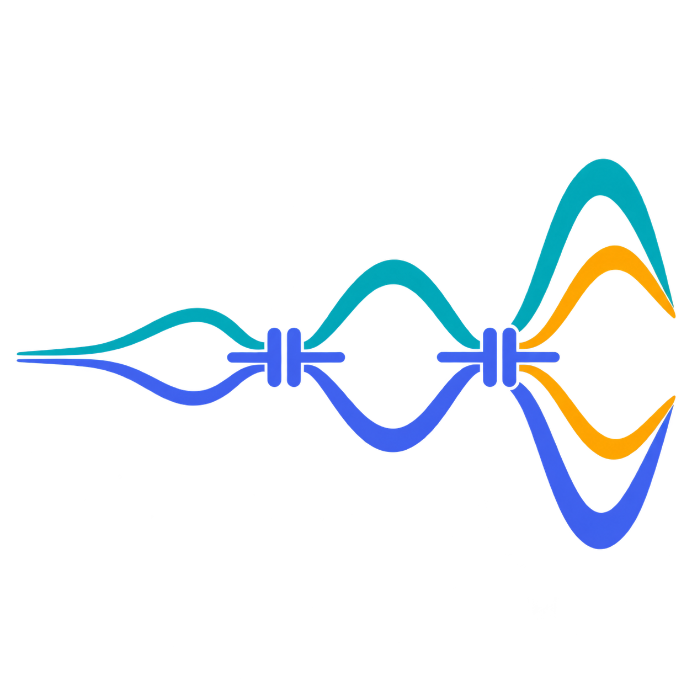

<p align="center">
  
</p>
<h1 align="center">TWPA Sim</h1>
<p align="center">Circuit, gain and quantum-noise models for superconducting parametric amplifiers.</p>
<p align="center">
  <a href="https://github.com/mandalsoumyajit/twpa-sim/actions/workflows/tests.yml"></a>
  &nbsp; Python 3.10+ &nbsp; · &nbsp; MIT License
</p>

Model kinetic-inductance traveling-wave amplifiers, Josephson junction chains,
flux-biased rf-SQUID/SNAIL chains, and resonant JPAs with explicit circuit and
operating parameters. Calculate dispersion, gain, pump depletion, internal
loss and quantum noise. An optional **JoSIM** backend compares the Josephson
models with physical RCSJ transient circuits.

**Start here:** [HOWTO and commented examples](HOWTO.md) ·
[Documentation](docs/README.md) · [Conventions](docs/conventions.md) ·
[References](docs/references.md)

**Layout:** [Process profiles, GDS generators and KLayout checking](docs/layout.md)
cover the research-grade NY CREATES KIT reference and illustrative JPA/JTWPA
geometries. Install `.[layout]` and run `python examples/layout/generate_all.py`.
Profiles distinguish reference dimensions from assumed rules; JJ layouts need
a real process adapter and EM extraction before fabrication.

**EM:** [JPA interconnect, kinetic and coupling extraction](docs/magnetic-extraction.md)
combines London-aware FastHenry finite-conductor matrices with openEMS
capacitor extraction. It retains physical returns, contacts and signed mutual
coupling, then validates the full-sine annotated circuit against JoSIM.
See the [numerical agreement](docs/magnetic-jpa-validation.md).

## Choose a model

| Device / question | Python interface | What it calculates | Guide |
| --- | --- | --- | --- |
| Kinetic-inductance TWPA / periodic ladder | `Cell`, `Design`, `small_signal`, `nonlinear` | ABCD/Bloch dispersion, 3WM gain, depletion and gradients | [KIT](docs/kit-twpa.md) |
| KIT with dielectric TLS loss | `IDCGeometry`, `oxide_design`, `TLS`, `coupled` | Field participation → lossy propagation → gain and bath noise | [TLS pipeline](docs/kit-twpa.md#tls-loss-and-noise) |
| Kerr-pumped resonant JPA | `jpa` | Stable pump roots, reflection gain, internal-loss noise and transients | [JPA](docs/resonant-jpa.md) |
| Effective flux-pumped resonant JPA | `jpa.flux_response`, `jpa.quadratures` | Sideband gain, degenerate quadrature gains and squeezing spectra | [Flux pumping](docs/resonant-jpa.md#flux-pump-and-degenerate-quadratures) |
| Junction-chain 4WM JTWPA | `jtwpa` | Finite-port harmonic balance, resonant phase matching, depletion and quantum noise | [4WM](docs/four-wave-jtwpa.md) |
| rf-SQUID / SNAIL 3WM JTWPA | `three_wave` | Full potentials, screening/rectification, harmonics, depletion and pump-only noise | [Josephson 3WM](docs/three-wave-josephson.md) |

The KIT propagation and finite Josephson circuit APIs have distinct
normalizations and scopes. A custom KIT Kerr coefficient does not turn that
solver into a Josephson model. See [units and model boundaries](docs/conventions.md).

## Install

From a source checkout:

```powershell
git clone https://github.com/mandalsoumyajit/twpa-sim.git
cd twpa-sim
python -m venv .venv
.\.venv\Scripts\python -m pip install -e .
.\.venv\Scripts\python examples/howto/03_kerr_jpa.py
```

On Linux/macOS replace `.\.venv\Scripts\python` with `.venv/bin/python`.
NumPy and SciPy are the core dependencies. Install `-e ".[plot]"` for optional
plots. JoSIM is installed separately and is not needed for the Python models,
the HOWTO's default examples, or ordinary tests. MATLAB and KLayout are not required.

## A first traveling-wave calculation

```python
from twpa import jtwpa

# SI units: Ic in A, capacitances in F, frequencies in Hz, power in W.
chain = jtwpa.Chain(critical_current=1.3e-7, ground_capacitance=1e-12,
                    junction_capacitance=1e-12, cells=64)
noise = jtwpa.quantum_noise(chain, pump_frequency=1e9, pump_power=7e-14,
                            signal_frequency=.9e9)
print(noise.gain_db, noise.added_noise, noise.quantum_limit)
```

This is a synthetic small-signal 4WM example: the idler is at 1.1 GHz.
Input-referred noise uses vacuum variance 1/2; its finite-gain bound approaches
half a quantum only at high gain. Use the [commented 4WM example](examples/howto/05_four_wave_jtwpa.py)
for internal loss, and the [HOWTO](HOWTO.md) for other families and numerical checks.

## Validation you can inspect and reproduce

Tests cover analytic limits, conservation, source regressions, thermal
equilibrium, commutator preservation and covariance uncertainty. Physical
JoSIM comparisons cover resonant JPA and 3WM/4WM Josephson circuits.

| Evidence | Report |
| --- | --- |
| Kerr/flux JPA gain, idler, compression and quadratures | [JPA vs JoSIM](docs/josim-validation.md) |
| Uniform/RPM 4WM scattering, harmonics and depletion | [4WM vs JoSIM](docs/jtwpa-josim-validation.md) |
| rf-SQUID/SNAIL gain, DC phase, loss and depletion | [3WM vs JoSIM and quantum limits](docs/three-wave-validation.md) |
| 4WM vacuum/thermal loss baths and finite-gain limits | [Quantum-noise checks](docs/jtwpa-quantum-validation.md) |
| JPA London interconnect, kinetic energy, pickup coupling and full-sine response | [Field extraction and JoSIM](docs/magnetic-jpa-validation.md) |

Reports record physical parameters, numerical sensitivity and run provenance.
Classical JoSIM traces validate deterministic response; they do not measure
quantum vacuum noise. Benchmarks do not establish agreement with a fabricated
device or certify stability for a new distributed-amplifier operating point.

```powershell
python -m unittest discover -s tests -v
python tools/check_documentation.py --run-examples
```

The [backend guide](docs/josim-backend.md) covers native and Windows/WSL
execution. [HOWTO example 08](examples/howto/08_josim.py) is a dry run by
default and can save a deck or run an explicitly supplied simulator.

## Scientific background and citation

Starting points include [Eom et al.](https://doi.org/10.1038/nphys2356) and
[Malnou et al.](https://doi.org/10.1103/PRXQuantum.2.010302) for KIT amplifiers,
[O'Brien et al.](https://doi.org/10.1103/PhysRevLett.113.157001) for resonant
phase matching, [Eichler and Wallraff](https://doi.org/10.1140/epjqt2) for JPAs,
and [Caves](https://doi.org/10.1103/PhysRevD.26.1817) for amplifier noise limits.
The [annotated references](docs/references.md) connect these and the
rf-SQUID, SNAIL, TLS and JoSIM literature to specific modules; bibliography
entries are available in [references.bib](references.bib).

Cite the software version/commit used via [CITATION.cff](CITATION.cff), along
with the relevant physical-model references. See [Contributing](CONTRIBUTING.md),
the [roadmap](docs/josephson-roadmap.md) and [MIT License](LICENSE).
The [source audit](docs/source-audit.md) records the original KIT implementation's provenance.
