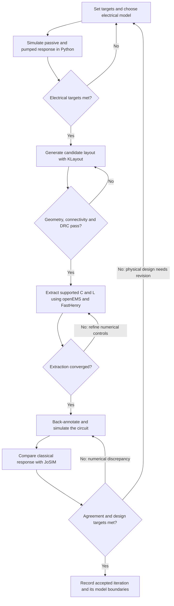

# Design cycle: simulate, lay out, check and revise

The goal is a circuit that meets an amplifier specification **and** a layout
whose checked geometry predicts that circuit's behavior. Work in a loop:
start with an electrical model, make a candidate layout, check its geometry,
extract supported physical parameters, and simulate the updated circuit.
Revise the circuit, geometry or numerical settings according to what failed.

You can stop after an electrical study if layout is outside your question.
The complete layout/field/circuit feedback path currently has a resonant
single-junction JPA benchmark. Other families have electrical solvers,
layout generators and, for Josephson circuits, JoSIM comparisons, but do not
yet have equivalent automatic layout back-annotation. The coverage table
below makes that boundary explicit.

Before starting, read [Tools and setup](tools-and-setup.md). Python with NumPy
and SciPy is the core. KLayout enters at layout checking, openEMS/CSXCAD and
superconducting FastHenry at supported field extraction, and JoSIM at
independent classical circuit comparison.



`C` and `L` in this diagram mean capacitance and inductance.
DRC means design-rule checking. “Agreement” means agreement between the Python
and transient descriptions of the same circuit; “targets” means the desired
device performance. Those are separate decisions: two solvers can agree on a
design that has inadequate gain or bandwidth.

## What happens at each stage?

| Stage | Inputs and tool | Output to keep | Check before moving on | If it fails |
| --- | --- | --- | --- | --- |
| 1. Define and simulate | Frequencies, gain/bandwidth/noise/power targets; electrical parameters; Python model | Parameter/drive settings, passive and pumped results | Supported operating regime, useful passbands, gain/noise/depletion and numerical sensitivity | Revise electrical parameters or drive, or choose a more complete model |
| 2. Lay out | Process profile, circuit-compatible dimensions; generator/KLayout Python | GDS plus its design/process manifest | Junction area, capacitor dimensions and intended wiring represent the chosen circuit | Revise geometry or reconcile electrical targets with process densities |
| 3. Check geometry | Exported GDS and manifest; Python checks and optional independent native KLayout deck | JSON/marker reports, native report when run | Width/spacing/grid rules, intended connectivity, no unintended islands/shorts | Fix the design/process interpretation, regenerate and recheck |
| 4. Extract | Checked geometry, material stack and fixed terminals; openEMS/CSXCAD and Whiteley FastHenry | Raw solver inputs/matrices, logs and accepted extraction certificates | Mesh/domain/time or current-basis refinement, signs, positive energy and source identity | Refine numerical controls; correct a geometry/material/terminal error if that is the cause |
| 5. Back-annotate and simulate | Certified capacitance/inductance plus explicit junction/loss/embedding assumptions; Python | Back-annotation record and updated response | Shifted modes, loading, stable supported pump point and required performance | Revise layout/electrical assumptions and repeat the affected stages |
| 6. Compare and accept | Same physical circuit/drive; JoSIM plus Python measurement | Netlist, runtime provenance, measured response and convergence comparisons | Passive and pumped agreement, timestep/settling sensitivity, and design targets | Diagnose numerical/model differences; change physical design only for a physical performance problem |

At stage 1, the [HOWTO](../HOWTO.md) supplies family-specific learning cases.
The [numerical-method guide](numerical-methods.md) explains why a converged
root, a stable pump, and an adequate physical model are different requirements.

## Coverage by device family

| Family | Electrical model and quantum noise | Candidate layout/checks | Independent circuit comparison | Layout-derived circuit feedback |
| --- | --- | --- | --- | --- |
| KIT, including coupled TLS loss/amplifier | Yes, within the documented propagation/loss approximations | KIT generator and process-profile checks | Analytic/source regressions; the JoSIM adapters target Josephson circuits | No complete generated-KIT EM/back-annotation flow yet; the separate oxide edge calculation is not a full mask extraction |
| Resonant single-junction JPA | Effective-mode models and physical circuit models; quantum noise is available in the effective model | Bare or pickup-loop generator and checks | JoSIM passive/pumped classical comparisons | Supported hybrid MIM-capacitance plus London-interconnect/pickup extraction; full extracted five-state comparison is classical |
| Flux/SQUID JPA | Effective flux model and physical SQUID adapter | Illustrative SQUID layout/checks | JoSIM flux/sideband/quadrature comparisons | General SQUID-layout extraction/back-annotation is not implemented |
| 4WM JTWPA | Finite circuit, depletion and Gaussian internal-loss noise | Uniform junction-chain generator/checks; constrained sizing helper | JoSIM circuit comparisons | Generated-chain EM extraction/back-annotation is not implemented |
| rf-SQUID/SNAIL 3WM JTWPA | Flux-biased elements, finite circuit and pump-only Gaussian noise | Illustrative loop/chain generators and checks | Physical loop/coil JoSIM comparisons | Generated-loop/chain EM extraction/back-annotation is not implemented |

For the supported JPA path, extraction covers a MIM capacitor component and
the finite metal-current network. Electric stray capacitance outside that
component, package/radiation effects and process qualification remain outside
the benchmark. A final acceptance record should state those boundaries along
with the numerical results.

## Worked JPA cycle

This example uses the illustrative two-metal Josephson process. It makes the
iteration concrete without prescribing performance targets for a real device.
Run commands from the repository root. Paths under `validation/runs/` are
regenerable working artifacts; keep each accepted/rejected iteration separate.

### 1. Simulate an initial electrical candidate

Use Python to study a full-sine resonant circuit with assumed interconnect and
pickup inductance. Here `I_c` is critical current, `C_s` shunt capacitance,
`C_j` junction capacitance, and the two self inductances and signed mutual
inductance describe the tank/pickup network. They are **initial assumptions**,
not field-extracted values. The pickup is connected to a 50 ohm port.

```python
import numpy as np
from twpa.em import CoupledJPA
from twpa.em.coupled_jpa import pump, response

candidate = CoupledJPA(
    critical_current=20e-6, shunt_capacitance=144e-15,
    junction_capacitance=240e-15,
    interconnect_inductance=140e-12, pickup_inductance=55e-12,
    mutual_inductance=4e-12, port_impedance=50.)
mode = candidate.modes()[0]
linewidth_hz = mode['kappa']/(2*np.pi)  # kappa is an angular energy-decay rate.
pump_frequency = mode['frequency'] - .5*linewidth_hz
operating_point = pump(candidate, pump_frequency, power=5e-15)
signal_frequencies = pump_frequency + np.array([.25, .5])*linewidth_hz
result = response(operating_point, signal_frequencies)
print('Lower mode (GHz):', mode['frequency']/1e9)
print('Signal power gain (dB):', 10*np.log10(result['gain']))
print('Idler photon conversion:', result['idler_conversion'])
```

For these assumptions the lower mode is approximately 33.173 GHz, with
signal gains about 1.416 dB and 0.564 dB at the two selected probe offsets.
Those values describe the initial electrical candidate. The field-derived
layout can shift both resonance and loading, which is why the cycle returns
to circuit simulation after extraction.

Inspect the passive response and repeat with refined pump harmonics/sidebands
before choosing a design point. Define acceptable frequency, gain and loading
ranges for your use case. This particular extracted-network model does not
yet provide its own quantum-noise adapter; use the documented effective JPA
noise model only when that reduction is appropriate.

### 2. Generate iteration 001

Install the layout extra, create an iteration folder and copy an editable
design input. Keep the process profile separate from device dimensions:

```powershell
python -m pip install -e '.[layout]'
New-Item -ItemType Directory -Path validation/runs/design-cycle/iteration-001
Copy-Item examples/layout/jpa_inductive.json validation/runs/design-cycle/iteration-001/design.json
python -m twpa.layout generate --process jj_overlap_illustrative --design validation/runs/design-cycle/iteration-001/design.json --output validation/runs/design-cycle/iteration-001/jpa.gds
```

These folder/copy commands use PowerShell; the Python commands are the same
on other systems. The input has a 2 um square junction, a 12 by 12 um capacitor
annotation and a pickup loop with an 8 um gap. The process's illustrative area
densities imply nominal `I_c=20 uA`, `C_j=240 fF` and `C_s=144 fF`, matching
the candidate's junction/capacitor assumptions. Its inductances remain
assumed until extraction. The GDS and `.manifest.json` record the generated
geometry and those process estimates; actual electrode fields can differ
from the area estimate.

### 3. Check the exported layout and fix geometric failures

```powershell
python -m twpa.layout check validation/runs/design-cycle/iteration-001/jpa.gds --report validation/runs/design-cycle/iteration-001/check
```

Read `check.json` and inspect the marker database `check.lyrdb` in KLayout.
The command returns nonzero on a failed check. A clean report means the
requested geometry/connectivity/rules passed for this profile; it does not
mean the amplifier meets its electrical targets. `--geometry-only` omits DRC
and must not be treated as a complete rule check.

For the independent native Ruby DRC deck, also install the KLayout application
and run the following in the main Python environment. Use the executable's
full path if `klayout` is not on `PATH`:

```python
from twpa.layout import load_process
from twpa.layout.native_drc import run_klayout_drc

report = run_klayout_drc(
    'validation/runs/design-cycle/iteration-001/jpa.gds',
    load_process('jj_overlap_illustrative'),
    'validation/runs/design-cycle/iteration-001/native.lyrdb',
    executable='klayout')
assert report['passed'], report
```

If a width, spacing or connection fails, edit `design.json`, regenerate and
repeat these checks before field extraction. If the process interpretation
itself was wrong, correct/version that profile and rerun affected designs.
Use the [layout guide](layout.md) for layer semantics and the checker scope.

### 4. Extract, back-annotate and compare

First complete the [external-tool setup](tools-and-setup.md): a matching
openEMS/CSXCAD worker interpreter, a selected superconducting FastHenry
installation, and a JoSIM build supporting the requested trace format.
The following is a template: replace all runtime paths and the installation
file with your actual values. It uses a Linux JoSIM executable through WSL;
omit `--wsl` for a native executable.

```powershell
python tools/validate_magnetic_jpa.py `
  --gds validation/runs/design-cycle/iteration-001/jpa.gds `
  --output validation/runs/design-cycle/iteration-001/extraction `
  --installation C:/path/to/fasthenry-installation.json `
  --openems-python C:/path/to/openems/python.exe `
  --openems-dll-directory C:/path/to/openEMS `
  --executable /path/to/josim-cli --wsl Ubuntu --corrector 4 `
  --workers 1 --step 2.5e-15
```

This driver carries out several stages rather than one monolithic field
simulation. FastHenry solves the metal-current network and its refinement
controls. openEMS solves the electric capacitor coupon and its controls.
Accepted artifacts supply the circuit's inductance matrix and shunt
capacitance. Python selects a supported pump for that updated circuit, then
JoSIM simulates the same circuit/drives and measures passive and pumped
response. This command requests corrector 4 and the driver's default NPY
trace format, so its selected JoSIM build must advertise both. Omitting the
corrector selects another numerical setting and needs its own validation;
coarse-precision CSV is not an equivalent replacement for long finely sampled
traces. The published reference's exact settings are in the
[validation report](magnetic-jpa-validation.md).

This benchmark driver uses the packaged illustrative electric and magnetic
stacks. Changing the mask's process JSON does not automatically change those
EM materials. For another supported stack, prepare and certify results through
the [electric](em-extraction.md#python-interface) and
[magnetic](magnetic-extraction.md) Python APIs, then pass matching `--electric`
and `--magnetic` artifacts to the driver. Keep thickness, dielectric gap and
operating-temperature penetration depths explicit.

| Result in the extraction folder | What to inspect |
| --- | --- |
| `jpa.gds` and `.manifest.json` | Exact copied source for this field/circuit run |
| `magnetic-certified.json` | Signed total inductance matrix, material/terminal assumptions and all magnetic convergence checks |
| `electric-certified.json` | Extracted capacitance, geometry and electric convergence checks |
| `backannotation.json` | Circuit parameters, their origins, modes and extraction identities |
| `response.json` | Passive reflection, pumped signal/idler, Python/JoSIM agreement and spectral-refinement gates |
| Per-case inputs, run records and logs | Diagnose solver/runtime failures and reproduce the calculation |

The script stops on failed field or circuit acceptance. It does not optimize
the design for your chosen frequency or gain target. The
[magnetic guide](magnetic-extraction.md) gives finer controls and the
[electric guide](em-extraction.md) explains the component extraction.

### 5. Decide what to change

First ask whether the problem is numerical or physical:

| Observation | Revision and next step |
| --- | --- |
| GDS width/space/contact violation | Change geometry or correct the process interpretation; regenerate and return to stage 3 |
| Extracted parameters change too much with mesh/current basis | Refine those controls at fixed geometry/terminals; repeat stage 4 |
| Python and JoSIM disagree for the same circuit | Check time/spectral resolution, acquisition, drive normalization, selected branch and model approximation before changing geometry |
| The two circuit solvers agree, but resonance is outside the target | Revise capacitor/junction/interconnect design, then repeat simulation, generation, checking and extraction |
| Loading or gain bandwidth misses the target | Revisit pickup geometry, port embedding and pump point; then recheck the affected geometry/circuit |
| Noise is unacceptable in an electrical family model | Revisit internal loss, bath temperature, coupling and operating point within that model's scope |

For example, a pickup gap change modifies mutual coupling and port loading;
it is not a direct “gain” control. To explore a 10 um gap, make a new input:

```powershell
New-Item -ItemType Directory -Path validation/runs/design-cycle/iteration-002
Copy-Item validation/runs/design-cycle/iteration-001/design.json validation/runs/design-cycle/iteration-002/design.json
```

Edit **the new file**, changing only `geometry.coupler_gap` from `8` to `10`,
then regenerate and recheck:

```powershell
python -m twpa.layout generate --process jj_overlap_illustrative --design validation/runs/design-cycle/iteration-002/design.json --output validation/runs/design-cycle/iteration-002/jpa.gds
python -m twpa.layout check validation/runs/design-cycle/iteration-002/jpa.gds --report validation/runs/design-cycle/iteration-002/check
```

Repeat the native DRC check for this GDS, then the stage-4 extraction command
with both input and output paths changed to `iteration-002`. Compare its
extracted response with iteration 001 and the original targets. Record the
reason for the change and its effect on mode frequency, linewidth and gain.
The gap change does not imply that a 10 um design is better.

Changing junction area changes both critical current and junction capacitance
through the selected process densities. Changing capacitor dimensions changes
its electric fields as well as the area estimate. After either change, use
new extraction results rather than manually editing an old certificate.

### 6. Keep a reproducible accepted iteration

Keep targets, electrical assumptions, editable design/process/material inputs,
GDS/manifest, geometry reports, extraction certificates, circuit records and
the measured response together. Record code revision, executable versions,
binary hashes, drive and numerical controls. A final record should explain
both why the design meets its targets and what effects remain outside the model.

The extraction driver requires a fresh output directory. To refine numerical
controls for the **same** layout, reuse certified `--magnetic`/`--electric`
artifacts only if their exact GDS, manifest, process and design identities
still match. A revised layout needs new extraction. A longer settling or
acquisition window may also be necessary when a geometry change narrows the
mode linewidth; the driver's tone-separation preflight rejects an unresolved
window. Passing a previous iteration's test is not acceptance of the new one.

Use the [validation reports](README.md#validation-and-provenance) as examples
of how to document these comparisons, and return to the
[family guides](README.md#device-guides) for the relevant electrical physics.
