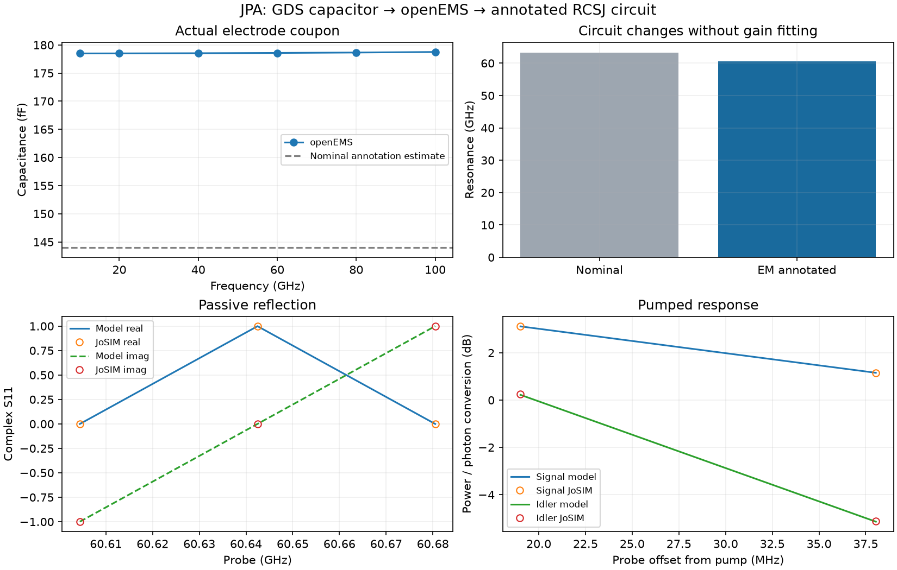

# JPA extraction and annotated-circuit validation

This initial benchmark asks whether the capacitance of actual drawn shunt
electrodes, computed by openEMS, can replace an area estimate and predict
the same resonant amplifier response as a physical JoSIM circuit. It keeps
ideal intercomponent connections; the later [London-network report](magnetic-jpa-validation.md)
adds finite metal inductance and pickup coupling. Read the
[electric workflow](em-extraction.md) for the component domain and assumptions.

EM means electromagnetic field extraction; GDS is the layout exchange file;
PEC is the perfect-electric-conductor electrode approximation. `Ic` is
junction critical current, `Cj` is junction capacitance, and shunt capacitance
is a separate component. A femtofarad (fF) is `1e-15` F. RCSJ means resistively
and capacitively shunted junction. Reported gain errors compare signal power,
whereas idler conversion is a photon-flux ratio. The field solve and the
subsequent nonlinear circuit comparison answer different validation questions.

Validated on **2026-10-28** with actual openEMS **0.37.0**, CSXCAD **0.7.0**
and JoSIM **v2.7.0e0ed0f**, using the enhanced build's four-iteration corrector
and phase formulation. The full source-build identifier and exact simulator
binary SHA-256 are recorded in the [numerical evidence](../validation/em-jpa-reference.json).
The binary identifies commit `0e0ed0fbf380399a4f53d9d8e55b33bb4c64cfc6`;
this is a build identifier, not an attestation of a clean source tree.

Lines in the response panels connect the tested points; they are not a dense
response sweep. This benchmark uses an illustrative process/stack. It checks
component-level capacitor extraction and deterministic classical circuit/model
consistency, not measured-device performance, quantum operation, or full-layout
electromagnetic parasitics.

## Geometry → EM → circuit

The single-junction JPA is generated by `JosephsonLayout(family='jpa')`.
Its nominal CAP annotation is 12 × 12 um², with an area-based 144 fF estimate.
The **actual** cropped bottom electrode is 196 um² and the top electrode is
170.5 um², including a clipped feed neck. Those actual polygons, rather than
the annotation area, are passed to openEMS as PEC sheets. The dielectric is
0.0664 um thick with relative permittivity 7.5, above a 3 um substrate with
relative permittivity 11.7. These are explicitly illustrative inputs.

The extracted shunt is **178.5822 fF**. The parallel-C fit's maximum complex
admittance residual is **0.0928%** over 10–100 GHz. The port voltage/current
tail diagnostic is below **2.4e-7** of its peak. The global fixed-step FDTD run
retains static-field energy; no global energy-decay convergence claim is made.

| Independent control | Primary / comparison | Largest capacitance change |
| --- | --- | ---: |
| Spatial mesh | 0.5 um lateral / 3 dielectric cells versus 1 um / 2 cells | 0.200% |
| Domain margin | 7 um versus 5 um | 0.000204% |
| Duration | 100,000 versus 50,000 steps | 0.0000633% |

All pass the fixed 2% refinement gate. Each comparison changes one control
group only. The final primary uses the finest mesh, largest domain and longest
duration of these runs. This establishes sensitivity for this coupon and
frequency band, not a universal extraction accuracy guarantee.

Back-annotation uses the GDS-measured 4 um² junction window and the explicit
illustrative process densities: `Ic=20 uA`, `Cj=240 fF`. Junction capacitance is
added **once**; it is outside the capacitor coupon. The EM-derived shunt
replaces the nominal 144 fF. External impedance 5 kOhm, internal resistance
10 MOhm and junction resistance 1 GOhm are separately supplied assumptions.
They are not extracted from PEC radiation or numerical real admittance.

This changes the reduced resonance from **63.3143 GHz** to **60.6425 GHz**,
a **4.22%** shift, without tuning anything against amplifier gain. Interconnect,
ground-return, kinetic, package and coupling/bias parasitics remain unextracted.

## Amplifier comparison against JoSIM

The EM-annotated RCSJ deck and reduced Kerr JPA use exactly the same fixed
`Ic`, `Cj`, shunt capacitance and damping assumptions. Passive reflection is
tested below, at and above resonance. The Kerr pump is at **60.59986 GHz**
with incident power **2.90343e-15 W**. Two weak probes use offsets of one-quarter
and one-half of the loaded linewidth. Pump-only subtraction and coherent
signal/idler fits determine the observed response.

The final reference integrates at **2.5 fs**, settles for **100 ns**, and
acquires from 100 to 200 ns, saving output every 0.2 ps. No noise sources are
enabled. The extremely weak classical probes are deterministic mathematical
tests, not claims of experimental signal resolvability or semiclassical
quantum-noise accuracy at this operating point.

| Quantity | Maximum final difference | Fixed acceptance gate |
| --- | ---: | ---: |
| Passive complex reflection | 0.000991 absolute amplitude | 0.02 |
| Pumped signal power gain | 0.0107 dB | 0.25 dB |
| Idler photon-flux conversion | 0.0208 dB | 0.25 dB |

Reducing the timestep from 5 fs to 2.5 fs changes measured signal gain by at
most **0.01193 dB**, and idler conversion by **0.02382 dB**. Passive reflection
errors decrease from 0.01557 at 10 fs to 0.003923 at 5 fs and 0.000991 at
2.5 fs. These sensitivities are comparable to the reported final discrepancies;
the results do not establish a tighter universal accuracy floor.

The retained shorter 10 fs run (30 ns discard, 100 ns stop) **fails** the idler
gate. Extending it to 100 ns discard/200 ns stop changes gain by up to
0.1081 dB and conversion by 0.2035 dB. This demonstrates why a simulator exit
code or a too-short acquisition cannot be accepted as amplifier validation.
No extraction values or acceptance limits were changed to hide that failure.

## Reproduction and regression

Use [validate_em_jpa.py](../tools/validate_em_jpa.py) as described in the
[workflow guide](em-extraction.md). It emits job JSON, copied worker source,
CSXCAD XML, field-solver logs/probes, a convergence-certified extraction,
`backannotation.json`, a reviewable RCSJ netlist and measured response summary.
The [capture tool](../tools/capture_em_jpa.py) builds the portable evidence and
plot from completed refinement runs. Raw JoSIM waveforms are regenerable and
removed after analysis by default; inputs/logs and compact measurements remain.

Tests check actual electrode footprints, junction-area binding, stale-layout
rejection, artifact integrity, missing/failed convergence, incompatible physical
comparisons, failure diagnostics and a single addition of junction capacitance.
Frozen real-solver regression re-evaluates the circuit-derived reduced model
and its gain/conversion gates. CI runs these tests without requiring a field
solver; the dedicated layout job also exercises geometry binding. Optional
live openEMS integration is enabled by `TWPA_OPENEMS_PYTHON` and, on Windows,
`TWPA_OPENEMS_DLL_DIRECTORY`.

The subsequent [London-network benchmark](magnetic-jpa-validation.md) adds
finite lead/return/contact inductance, kinetic energy and signed pickup
coupling, using a five-state circuit and independent JoSIM comparison.
This initial capacitor-only benchmark remains a distinct component check.
