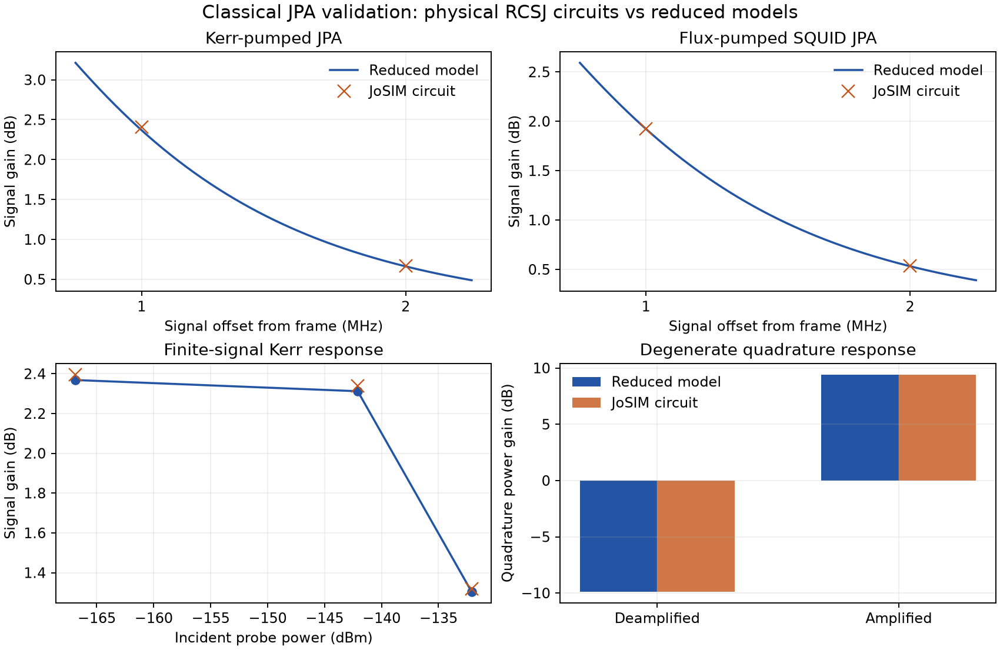

# Resonant JPA validation against JoSIM circuits

Validated on 2026-10-27 using the RCSJ transient simulator JoSIM,
build `v2.7.5f33997`, source revision
`5f33997c7c8a7317e98e3aa8c49ce4503375d9a2` of
[mandalsoumyajit/JoSIM](https://github.com/mandalsoumyajit/JoSIM).
The enhanced build's four-iteration corrector was enabled. Phase analysis
was used for the accepted reference runs.

The tests compare actual circuit transients with parameters derived from the
circuit, without fitting pumped gain or pair-drive strength to JoSIM results.
These are synthetic benchmark circuits, not characterized fabricated devices.



## Results

Reference runs use 0.5 ps integration steps, a 5 us stop time, discard the first
2 us, and save traces every 20 ps. Signal offsets are 1 and 2 MHz. Each result
uses a pump-only subtraction and simultaneous coherent tone fit at the port.

| Quantity | Largest circuit/model difference |
| --- | ---: |
| Passive complex reflection, three frequencies | 0.00391 absolute complex amplitude |
| Kerr-pumped signal power gain | 0.0363 dB |
| Kerr idler photon-flux conversion | 0.0713 dB |
| Finite-signal Kerr compression, three probe powers | 0.0282 dB |
| Flux-pumped signal power gain | 0.00051 dB |
| Flux-pumped idler photon-flux conversion | 0.00163 dB |
| Degenerate quadrature power gains | 0.00077 dB |
| Full real quadrature transfer matrix | 0.0106 absolute element error |

Thus the tested gain/conversion quantities agree within **0.08 dB**. The
acceptance gates were 0.25 dB for gains/conversions, 0.02 absolute error for
passive complex reflection, and 0.08 absolute matrix-element error for
quadrature transfer. These gates apply to the specified points and are not
universal accuracy guarantees.

The strongest Kerr probe reduces gain by approximately 1.08 dB relative to
the weakest probe in this sweep. This checks finite-signal compression against
the nonlinear envelope transient solver; it is not a searched or precisely
interpolated 1-dB compression threshold.

## Physical circuits and mapping

The Kerr circuit has one sinusoidal-CPR junction with Ic = 12.992583 uA,
Cj = 1 pF and RN = R0 = 1 GOhm, plus a 999 pF parallel capacitor,
a 5 kOhm internal resistance and a 50 Ohm Thevenin port.
The total capacitance is 1 nF, its classical LC frequency is 1 GHz,
kappa_external = 20e6 rad/s, kappa_internal = 200001 rad/s,
and the quartic Kerr coefficient is -121706.74 rad/s per photon.
The pump is at 998.199639 MHz with incident power 2.0594e-16 W,
corresponding to approximately 46.47 pump photons in the reduced model.

The flux circuit is a symmetric SQUID with two 7 uA junctions, each with
Cj = 0.5 pF and RN = R0 = 1 GOhm. It has a 999 pF shunt capacitor,
1 pH in each loop arm, a 1 nH coil and opposite mutual-coupling factors
+0.2/-0.2. Static external flux is 0.2 Phi0, established with a 100 ns
coil-current ramp. The static loop equation, linearized arm admittances and
their frequency/flux derivatives determine the reduced model.
The predicted resonance is 929.777653 MHz. Flux pumping at 1859.555305 MHz
uses amplitude 0.00160917 Phi0 and predicts a pair-drive magnitude of
5.05017e6 rad/s. This pair drive is calculated from circuit sensitivity,
not adjusted to match amplification.

Probe powers are 1e-22 W for linear sideband and quadrature measurements.
No thermal-noise sources are enabled, so these arbitrarily weak classical
probes measure deterministic circuit response. They are not a statement that
such a signal can be resolved experimentally without noise.
The finite-signal Kerr sweep uses 2.0594e-20, 6.1782e-18 and 6.1782e-17 W.

## Numerical convergence and simulator formulation

Two additional full suites use the same parameters with 3 us stop time and
1 us discard, at 1 ps and 0.5 ps integration steps. Halving the step changes
Kerr signal gain by at most 0.0405 dB, idler conversion by 0.0923 dB,
and quadrature gains by 0.0016 dB. The passive complex-reflection error drops
from 0.01621 to 0.00429, showing the narrow resonance's sensitivity to timestep.

At fixed 0.5 ps step, changing from the shorter suite to the reference's longer
settling/acquisition window changes Kerr gain by at most 0.0295 dB, idler
conversion by 0.0457 dB, compression gain by 0.0188 dB, and quadrature gains
by 0.0117 dB. These remaining numerical/window sensitivities are reported,
rather than treating one simulation as exact. Further refinement is appropriate
for a stricter accuracy target or a device closer to instability.

Initial voltage-mode SQUID runs showed a small static flux offset that grew
when the timestep was reduced. This rotated the quadrature axes despite
apparently satisfactory gain magnitudes. Switching to JoSIM's phase formulation
preserved the loop constraint: the reference's driven finite-window mean
junction phase is within 2e-7 rad of the static-bias prediction. The small
remaining difference includes averaging an AC-driven phase over a finite
window. The accepted reference does not use those voltage-mode runs.

## Reproduce and inspect

See [backend usage](josim-backend.md) for simulator configuration. Run the full
suite with `--compression`, first at `--step 1e-12`, then at `--step 5e-13`,
then with the latter step and `--start 2e-6 --stop 5e-6`. Use distinct output
directories. Each run preserves its deck, CSV, logs and manifest locally;
large raw waveforms are not committed to Git.

`tests/fixtures/josim_jpa.json` retains all three suites' numerical measurements,
physical parameters, predicted values, convergence changes and netlist hashes.
It records both raw-file and LF-normalized deck hashes because the first
Windows runs used CRLF files with manifests hashed before newline translation.
The backend now writes decks with explicit LF endings. The capture tool checks
the historical manifest against the raw or normalized hash without rewriting
the circuit that was actually simulated.

To regenerate the stored evidence after reproducing the runs:

```powershell
python tools/capture_josim_validation.py `
  --reference validation/runs/long --fine validation/runs/fine `
  --coarse validation/runs/coarse --output tests/fixtures/josim_jpa.json
```

`test_josim_reference.py` compares model calculations with these independent
circuit measurements in ordinary CI. `test_josim.py` tests backend failures,
normalization and circuit generation, and includes an optional live JoSIM
integration test controlled by environment variables.

## Scope of the evidence

The simulations validate deterministic passive response, nondegenerate gain,
idler conversion, finite-signal compression and phase-sensitive quadrature
transfer for these single-mode, weak-phase/weak-flux benchmarks.
They do **not** validate quantum added noise, vacuum squeezing noise,
noise-induced switching, above-threshold flux operation, junction-process
parameters or every possible JPA design. JTWPA circuit validation remains
future work. Quantum-noise identities remain separate analytic tests.
