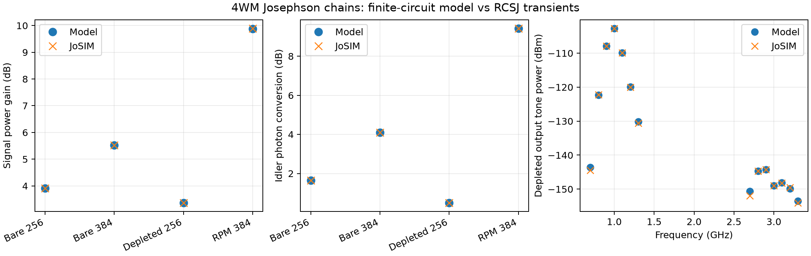

# JTWPA comparison with JoSIM circuits

The physical test is a transmission line of nonlinear Josephson junctions,
first without loading and then with added phase-matching resonators. We compare
its frequency-domain prediction with a classical time-domain circuit using
the same components. The [4WM guide](four-wave-jtwpa.md) explains the circuit,
the role of phase matching and its O'Brien reference.

In the parameter summary, `Lj` is zero-phase junction inductance,
`Ic=phi_bar/Lj` is critical current, and `phi_bar` is the reduced flux quantum.
`Cg` and `Cj` are node-to-ground and junction capacitances, `Rj` is junction
loss resistance and `R` is the port resistance. `fp`, `fs` and `fi` mean pump,
signal and idler frequencies. RPM means resonant phase matching. RCSJ means
resistively and capacitively shunted junction. All are electrical parameters;
the simulation does not derive them from a mask.

The 4WM solver is checked against full-sine RCSJ transient circuits, using
identical physical parameters and finite end loads. These are synthetic
benchmarks for the implementation, not calibration to a fabricated device.
The compact measurements and run hashes are committed in
[`tests/fixtures/josim_jtwpa.json`](../tests/fixtures/josim_jtwpa.json).
Raw netlists, CSVs, logs and manifests are retained locally under
`validation/runs/jtwpa/` and are excluded from Git because of their size.

## Circuit and measurements

All cases use Lj=2.5 nH (Ic=0.1316423914 uA), Cg=Cj=1 pF,
Rj=1 Gohm, no ground resistor, fp=1 GHz, fs=0.9 GHz and fi=1.1 GHz.
The chain contains 256 or 384 junctions. End shunts have half the interior
admittance. Both port resistances equal the real linear Bloch impedance at
the pump: 53.402533 ohm for the bare chain, 52.728607 ohm for RPM.
Incident pump power is .5*R*(.4*Ic)^2, approximately 7e-14 W.

The RPM circuit adds a 10 fF coupling capacitor and a parallel 1 pF,
24.929823 nH, 1 Gohm resonator at every interior node. Its bare resonance
is 1.008 GHz. All components of each end resonator are scaled to give
half its interior admittance. JoSIM includes junction capacitance in the
RCSJ model, without another parallel capacitor.

The source is a Thevenin voltage source in series with R. Incident/reflected
waves are extracted using source voltage and node voltage/current; the
output resistor has no incident wave. A joint coherent least-squares fit
extracts peak phasors. Signal/idler fits subtract a separate pump-only
trajectory, whereas pump transmission uses the full driven trajectory.
Passive runs use weak simultaneous tones, independently of the strong
probe used for depletion. The interior three-node recurrence measures Bloch
wavenumber even in the presence of reflections.

## Results

The model uses exact-sine Fourier projection, third-harmonic bands and
16-point quadrature per phase. Weak-probe cases retain one sideband pair;
the depleted case retains three. Gain and conversion below are linear
ratios; conversion is a photon-flux ratio.

| Circuit | Probe/pump power | JoSIM gain | Model gain | JoSIM conversion | Model conversion | Gain / conversion error (dB) |
| --- | ---: | ---: | ---: | ---: | ---: | ---: |
| Bare, 256 JJ | 1e-6 | 2.457334 | 2.457449 | 1.457880 | 1.457996 | -0.00020 / -0.00035 |
| Bare, 384 JJ | 1e-6 | 3.565837 | 3.566300 | 2.565527 | 2.566001 | -0.00056 / -0.00080 |
| Bare, 256 JJ, depleted | 0.1 | 2.173222 | 2.172964 | 1.123485 | 1.123113 | +0.00051 / +0.00144 |
| RPM, 384 JJ | 1e-6 | 9.755011 | 9.736375 | 8.751416 | 8.733562 | +0.00831 / +0.00887 |

Errors are 10*log10(JoSIM/model). At equal length (384 JJ) the predicted
gain increases from 5.522 dB to 9.884 dB with this resonator loading.
In the strong-probe case pump transmission is 0.721833 in JoSIM versus
0.721866 in the model; generated offset sidebands are included in the
depleted solve. The corresponding weak-probe pump transmission exceeds
0.9996. The RPM pump comparison is 0.997080 versus 0.999721 (-0.01149 dB).



Across final cases the largest passive complex S21 discrepancy is 0.00721,
S11 discrepancy is below 0.00018, and extracted wavenumber error is below
4e-5 rad/cell. These validate discretized dispersion, finite boundaries,
gain and conversion together.

## Resolution and transient limits

Final bare runs use 1 ps internal steps and acquire 200–300 ns. RPM uses
1 ps steps, a 200 ns exponential source turn-on and acquisition at
1.6–2.0 us. Output sampling is 10 ps. Near its resonance the RPM pump group
delay is about 79 ns, and abrupt startup produces appreciable ringing.
An earlier short-window result was excluded from the accepted fixture.

Bare 256 refinement from 2 ps / 100–200 ns to 1 ps / 200–300 ns changes
gain/conversion by less than 0.002 dB (a joint timestep/settling check).
RPM 2 ps to 1 ps, at the same late window, changes these by under 0.05 dB.
Splitting the final RPM acquisition into 1.6–1.8 and 1.8–2.0 us gives
late-minus-early changes of 0.01368 dB gain, 0.01450 dB conversion and
0.07867 dB pump transmission. These sensitivities exceed the mean
circuit/model signal discrepancy: the digits in the table are regression
values, not an uncertainty claim at the 0.001 dB level.

Increasing retained harmonics from 3 to 5 changes signal/idler results by
less than 0.001 dB. Increasing quadrature from 16 to 24 has negligible effect
at these points. Increasing depleted sidebands from 3 to 4 changes
conversion by about 0.00174 dB and gain by 0.00076 dB. An initial cubic
three-tone 128-JJ calculation differed in conversion by about 0.34 dB;
including full-sine third-harmonic mixing removed that truncation error.

## Reproduction and provenance

Install the package and configure a native or WSL JoSIM executable as in
the [backend guide](josim-backend.md). Example commands (PowerShell):

```powershell
python tools/validate_jtwpa_josim.py --executable /path/to/josim-cli `
  --wsl Ubuntu --corrector 4 --output validation/runs/bare256 `
  --cells 256 --step 1e-12 --stop 300e-9 --start 200e-9
python tools/validate_jtwpa_josim.py --executable /path/to/josim-cli `
  --wsl Ubuntu --corrector 4 --output validation/runs/depleted256 `
  --cells 256 --step 1e-12 --stop 300e-9 --start 200e-9 `
  --probe-ratio .1 --depleted --sidebands 3
python tools/validate_jtwpa_josim.py --executable /path/to/josim-cli `
  --wsl Ubuntu --corrector 4 --output validation/runs/rpm384 `
  --cells 384 --step 1e-12 --stop 2e-6 --start 1.6e-6 `
  --rpm-frequency 1.008e9 --ramp 200e-9
```

Use a fresh output directory each time. Set `--corrector` only if supported
by the executable. Omit `--wsl` for native execution. `--revision` is optional
user-supplied provenance; the actual binary version is also captured.
`check_jtwpa_resolution.py` recomputes model truncation checks;
`check_jtwpa_windows.py` refits raw records in half windows;
`capture_jtwpa_validation.py` freezes the selected runs with SHA-256 hashes.
`plot_jtwpa_validation.py` renders the figure from the committed fixture.

Runs used phase analysis and enhanced corrector 4 in the JoSIM fork.
Most binaries report v2.7.5f33997, built 2026-10-27 15:04:48, corresponding
to revision 5f33997c7c8a7317e98e3aa8c49ce4503375d9a2. The bare-384 run
reports v2.7.0e0ed0f, built 16:26:59: its supplied source-revision field
was stale after an external rebuild. The fixture explicitly flags this
mismatch and preserves both values; that run's binary version, not the
supplied revision, identifies its build. Raw manifests are retained intact.
The fixture does not attest to a clean source tree for either binary.

Regression tests recompute the model against the measured fixture, rather
than replacing circuit measurements with model outputs. Optional live
integration tests are enabled with `TWPA_JOSIM_EXECUTABLE` and, for WSL,
`TWPA_JOSIM_WSL`. The classical circuit comparisons do not validate quantum
added noise, vacuum fluctuations, dynamical stability across a gain sweep,
or behavior outside these circuit/drive ranges.
