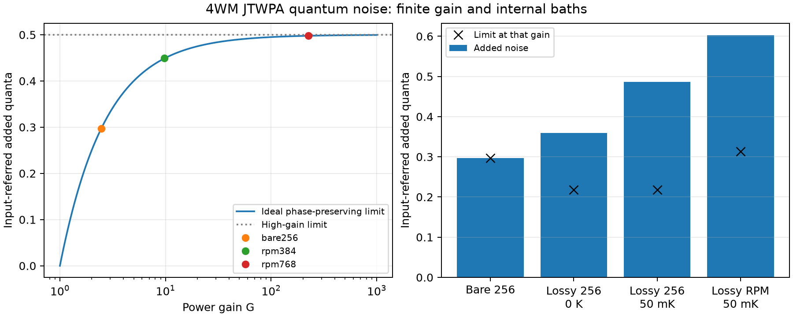

# 4WM quantum-noise validation

The quantum extension is checked against canonical commutators,
fluctuation-dissipation, covariance uncertainty, thermal equilibrium and
analytic amplifier/attenuator limits. These are mathematical/physical
consistency tests, not independent quantum measurements or quantum JoSIM
simulations. The classical circuit/Jacobian has separately been compared
with [JoSIM transients](jtwpa-josim-validation.md).

## Circuit benchmarks

The two nearly lossless circuits are the same 256-junction bare chain and
384-junction resonator-loaded chain used in the classical report. All cases
use Lj=2.5 nH, Ic=phi_bar/Lj, Cg=Cj=1 pF, fp=1 GHz, fs=0.9 GHz,
fi=1.1 GHz and available pump power .5*R*(.4*Ic)^2. Port impedances are
53.402533 ohm bare and 52.728607 ohm RPM. The nearly lossless cases use
Rj=1 Gohm and, for RPM, resonator R=1 Gohm, with no ground resistor.
An additional 768-junction extension of that RPM circuit checks noise above
20 dB gain; this longer circuit has not separately been simulated in JoSIM.

Lossy cases use Rj=20 kohm and Rground=100 kohm. Lossy RPM also uses
Rresonator=100 kohm. Ground and resonator end admittances are half the
interior values. Internal temperatures are either 0 K or 50 mK as indicated;
all incoming external ports remain in vacuum. The pump includes attenuation
from those same resistors before its differential quantum response is found.

| Circuit | Gain G | Added quanta | Finite-gain limit | Excess quanta |
| --- | ---: | ---: | ---: | ---: |
| Bare 256, nearly lossless | 2.457449 | 0.296996 | 0.296537 | 0.000459 |
| RPM 384, nearly lossless | 9.736375 | 0.449049 | 0.448646 | 0.000402 |
| RPM 768, nearly lossless | 224.690087 | 0.498156 | 0.497775 | 0.000381 |
| Bare 256, lossy, 0 K | 1.774923 | 0.359390 | 0.218298 | 0.141092 |
| Bare 256, lossy, 50 mK | 1.774923 | 0.485951 | 0.218298 | 0.267653 |
| RPM 384, lossy, 50 mK | 2.671881 | 0.602400 | 0.312866 | 0.289534 |

The comparison uses the finite-gain bound (1-1/G)/2; 1/2 is only its
high-gain limit. Internal loss increases the excess above the bound, and
raising the baths' temperature increases noise without changing the fixed
classical circuit parameters or gain. The nearly lossless chains have a
small excess because finite reflections and extra frequency channels enter
the signal output. The model does not force ideal two-mode behavior.

## Independent checks

The nine quantum-noise unit tests cover:

1. An ideal two-mode amplifier with gains 1, 2, 10 and 1e6: added noise is
   (1-1/G)/2, spontaneous output occupation is G-1, and the high-gain result
   approaches 1/2. Thermal idler noise scales as (1-1/G)*(n_idler+1/2).
2. Pump-off finite S11/S21 agree with the independent ABCD calculation.
   A lossless circuit maps vacuum to vacuum without creation scattering.
3. Each internal loss family separately preserves cold output vacuum when
   its bath is present. Omitting those bath transfer matrices produces a
   commutator defect greater than 0.01 in the selected lossy test circuits.
   Cold attenuation gives the exact added noise (1-eta)/(2*eta), including
   reflection as an unobserved port.
4. With all ports and baths at the same finite temperature, output occupation
   at every frequency is the Bose occupation. With only the internal circuit
   hot, passive output noise is 1/2 + absorption*n_thermal, where absorption
   is independently found from S11 and S21.
5. Pumped photon-normalized signal gain and idler conversion match the
   classical small-signal Jacobian used in the JoSIM comparisons. At vacuum,
   added noise exceeds the amplifier limit by exactly the unwanted
   annihilation-channel weight divided by G.
6. Both bosonic commutator identities and the full multimode covariance
   uncertainty condition hold for lossy pumped circuits, thermal profiles,
   cubic and exact-sine models, and a coherently depleted operating point.
   The latter is phase sensitive and correctly has no scalar
   phase-preserving added-noise figure.
7. Bath-family covariance contributions sum to the total. Heating one
   junction gives precisely its predicted transferred thermal covariance;
   heating an external idler also increases signal noise.
8. Increasing harmonic/Fourier resolution converges the result. Invalid
   temperatures and inadequate commutator tolerance are rejected rather than
   repaired by noise clipping or transfer-matrix renormalization.

Across the larger circuit benchmarks above, both commutator defects are
below 3e-13. The minimum eigenvalue of V+i*Omega/2 is nonnegative to
numerical precision. In the fully lossy RPM equilibrium check at 50 mK,
the maximum covariance error is 2.04e-14 quanta.

## Convergence, reproduction and limits

Defaults retain odd harmonics through 3, one sideband pair and 16 quadrature
points per torus phase. Increasing harmonics to 5 and quadrature to 24
changes added noise by -4.63e-6 quanta (bare 256) and -2.63e-6 quanta
(RPM 384), and by +2.76e-7 quanta for the 23.52 dB RPM 768 case.
These are truncation checks at specific benchmark points, not
universal error bars. A canonical truncated model may still omit physically
important frequency channels, so commutator preservation alone is insufficient
as a convergence test.

Run `python -m unittest discover -s tests -v` for the analytic checks.
`python tools/validate_jtwpa_noise.py --output validation/runs/quantum.json`
recomputes the larger benchmarks and harmonic refinements. Add
`--plot validation/runs/quantum.png` for the figure. The compact generated
[benchmark record](data/jtwpa-quantum.json) stores physical parameters,
temperatures, model controls, diagnostics and a source hash; it is explicitly
labeled as a model consistency calculation, not external measurement data.

The calculation assumes Gaussian fluctuations around a classical solution.
It does not certify that solution's dynamical stability or include
spontaneous-emission depletion of the pump. Quantum noise near an unstable
or strongly fluctuating state requires additional analysis. See the
[API and derivation](jtwpa-quantum-noise.md) for covariance conventions,
phase-sensitive outputs and complete model scope.
