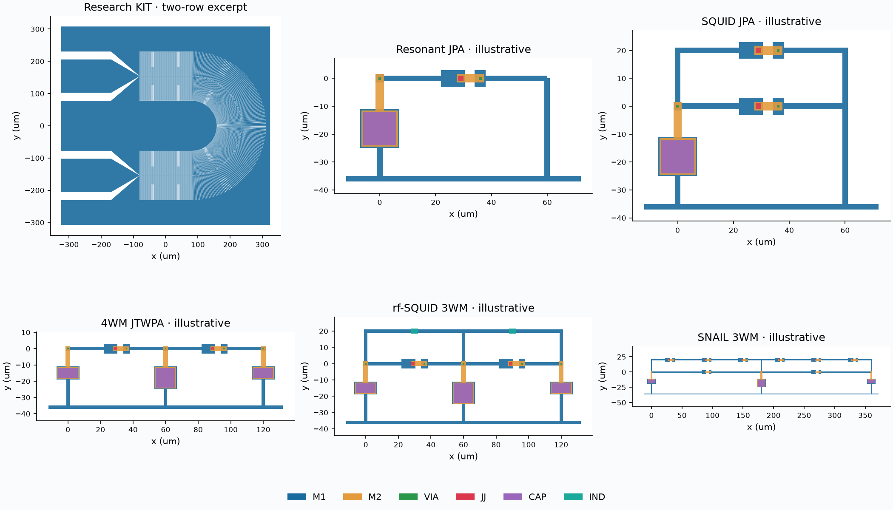

# Process-aware layout generation

The optional `twpa.layout` package writes GDS and self-contained design/process
manifests, then checks the **exported** geometry using KLayout. It includes a
parameterized port of the research-grade NY CREATES KIT serpentine and
illustrative Josephson layouts. These are starting geometries for extraction,
not calibrated masks for fabrication.



## Processes first

Two editable JSON profiles ship inside the installed package:

| Profile | Basis | Qualification |
| --- | --- | --- |
| [kit_nycreates_research](../src/twpa/layout/processes/kit_nycreates_research.json) | Original single-routing-layer NbN geometry, bump pads and passivation opening map | Research-grade NY CREATES reference; fabrication minima were not supplied |
| [jj_overlap_illustrative](../src/twpa/layout/processes/jj_overlap_illustrative.json) | Independently chosen two-metal overlap junctions, galvanic contacts and MIM capacitors | Illustrative engineering assumptions; no vendor PDK |

The [process contract](process-contract.md) documents every field and executable
rule. Copy a profile to create a local process; preserve provenance and replace
assumptions explicitly. `load_process()` validates JSON, finite values, stream
mapping, grids, units, source references and supported rule semantics without
requiring KLayout. Unknown rule kinds fail instead of being treated as passing.
See the [source review](process-source-review.md) for what was learned from the
local SFQ and `spec2si-seeqc` projects and what remains process-specific.

## Generate and check

From the repository root, after activating your Python environment:

```powershell
python -m pip install -e '.[layout]'
python -m twpa.layout generate --process kit_nycreates_research --design examples/layout/kit_small.json --output validation/runs/layout/kit.gds
python -m twpa.layout check validation/runs/layout/kit.gds --report validation/runs/layout/kit-check
python examples/layout/generate_all.py
```

`generate` writes `.gds` and `.manifest.json`. `check` writes `.json` and
`.lyrdb`, and exits nonzero on violations. Open GDS and the corresponding
marker database in KLayout to inspect failures. Generated files go under
ignored `validation/runs/`; do not commit bulk mask exports.

Run `python examples/layout/generate_all.py --full-kit` for the **49,950-cell**
16-row reference size. Small examples are preferable during development;
full-size boolean geometry and DRC take longer.

## Device generators

| Family | Geometry / topology | Example |
| --- | --- | --- |
| KIT | Straight IDC loading supercells, biased sheet-squares-matched U-turns, constant-width radial fingers, CPW launches, bump landings and opening | [Small](../examples/layout/kit_small.json), [reference size](../examples/layout/kit_reference.json) |
| Resonant JPA | One JJ in parallel with one MIM capacitor, exposed signal and ground terminals | [JPA](../examples/layout/jpa.json) |
| SQUID JPA | Two parallel JJs forming a loop, with a shunt capacitor | [SQUID](../examples/layout/squid_jpa.json) |
| 4WM JTWPA | Series JJ chain with shunts and symmetric half-shunts at both endpoints | [4WM](../examples/layout/jtwpa4wm.json) |
| rf-SQUID 3WM | JJ in parallel with an uncalibrated wire-loop inductor, repeated along a shunted line | [rf-SQUID](../examples/layout/rfsquid3wm.json) |
| SNAIL 3WM | Small JJ in parallel with a series array of large JJs, repeated along a shunted line | [SNAIL](../examples/layout/snail3wm.json) |

All dimensions are in **um**. Counts are integers. JSON rejects unknown fields.
Python users can instantiate `KITLayout` or `JosephsonLayout` from
`twpa.layout.generate`. `KITLayout.from_process(process, **overrides)` seeds
reference geometry from the chosen profile. The CLI does this automatically.
Overrides live in the design JSON; process rules remain independently checked.

The KIT primitive construction follows the original generator, but this port
has configurable dimensions, loading, rows and counts; pads are placed from
the chosen row geometry. It does **not** reproduce every original pad position
or the folded/two-column/four-pass variants. Two ground combs remain separate
on-chip and need package grounding. The turn-width calculation is the original
approximate sheet-squares match, not an EM verification of impedance or gain.

Josephson layouts use an explicit illustrative overlap stack. `M1` and `M2`
are insulated except at `VIA` contacts or `JJ` tunnel windows. `CAP` marks a
dielectric capacitor area; `IND` marks a conductor cross-section used for
connectivity extraction. **CAP and IND are annotations, not fabrication masks.**
They must remain in the verification GDS and be omitted from any eventual
mask export under a real process adapter.

## Bind electrical and geometric parameters

Each JJ manifest records drawn area, assumed fabricated area, `Ic` and `Cj`.
Each capacitor records area and estimated capacitance. Values are SI A/F;
geometrical areas remain um². In the illustrative profile:

\[
I_c = J_c A,\qquad C_j=c_j A,\qquad C_{\rm shunt}=c_{\rm MIM} A_{\rm MIM}.
\]

There is no automatic bias correction: fabricated area is assumed equal to
drawn area. Densities are illustrative. Fringing, substrate participation,
lead inductance/capacitance, loop inductance, flux coupling and packaging
require extraction/calibration.

For a compatible bare JPA or uniform 4WM circuit, use the constrained sizing
helper. It rounds to the process grid and rejects incompatible `Ic`/`Cj`
targets instead of silently changing a circuit:

```python
from twpa.jpa_circuit import ParallelJPA
from twpa.layout import load_process
from twpa.layout.bindings import from_circuit
from twpa.layout.generate import generate

p = load_process('jj_overlap_illustrative')
# Ic=20 uA and Cj=240 fF share an illustrative 4 um² junction area.
circuit = ParallelJPA(critical_current=20e-6,
                      shunt_capacitance=144e-15,
                      junction_capacitance=240e-15)
geometry = from_circuit(circuit, p)
generate(geometry, p, 'validation/runs/layout/sized-jpa.gds')
```

For `jtwpa.Chain`, `cell_length` supplies the layout pitch unless explicitly
overridden; the primitive requires at least 40 um. Resonant phase-matching
loads are rejected by this sizing helper. Port impedances, internal-loss
resistors, bias coils, coupling capacitors and bias tees are external to the
initial layouts. SQUID/SNAIL loop geometries do not yet synthesize a target
inductance or flux bias. Use the manifest estimates to build or check a
consistent circuit after extraction; the previous JoSIM benchmarks do not
validate a newly generated mask's parasitics.

## Independent geometry and DRC decks

[geometry.py](../src/twpa/layout/decks/geometry.py) runs with the standalone
KLayout Python API. It reads GDS and checks die containment, stream map,
component shapes/counts, contacts and annotated circuit connectivity. M1/M2
polygons merge electrically only through actual contact geometry. Junctions
and capacitors remain circuit edges; annotated inductors are cut only in the
extraction view. Pin and component terminal assignments detect opens, shorts
and unassigned conductor islands. This is an annotated connectivity check,
not a general-purpose foundry LVS extractor.

[process.drc](../src/twpa/layout/decks/process.drc) independently executes the
JSON rule set in the **native Ruby DRC engine** of a full KLayout installation.
The wrapper validates the profile, saves the process snapshot, and reads the
actual report database. A zero KLayout exit code alone does not imply no DRC
violations:

```python
from twpa.layout.native_drc import run_klayout_drc
result = run_klayout_drc('validation/runs/layout/sized-jpa.gds', p,
                        'validation/runs/layout/native.lyrdb',
                        executable='klayout')
assert result['passed'], result
```

On Windows, use the full path to `klayout_app.exe`. Or pass `--klayout` to the
[all-family example](../examples/layout/generate_all.py). A raw native command:

```powershell
klayout -b -r src/twpa/layout/decks/process.drc -rd input=design.gds -rd process=profile.json -rd report=design.lyrdb
```

The Python checker also runs KLayout width/spacing/enclosure/grid operations,
so the core workflow works with the pip dependency alone. Geometry-only mode
explicitly reports `drc_executed=false`; it is not a substitute for a DRC run.
Reports record hashes, qualification and rules executed. Editing a GDS changes
its recorded hash but permits rechecking against the same design intent.

See [validation evidence and remaining work](layout-validation.md). KLayout
APIs are documented in its [standalone Python manual](https://www.klayout.org/klayout-pypi/)
and [DRC runset manual](https://www.klayout.de/doc/manual/drc_runsets.html).
