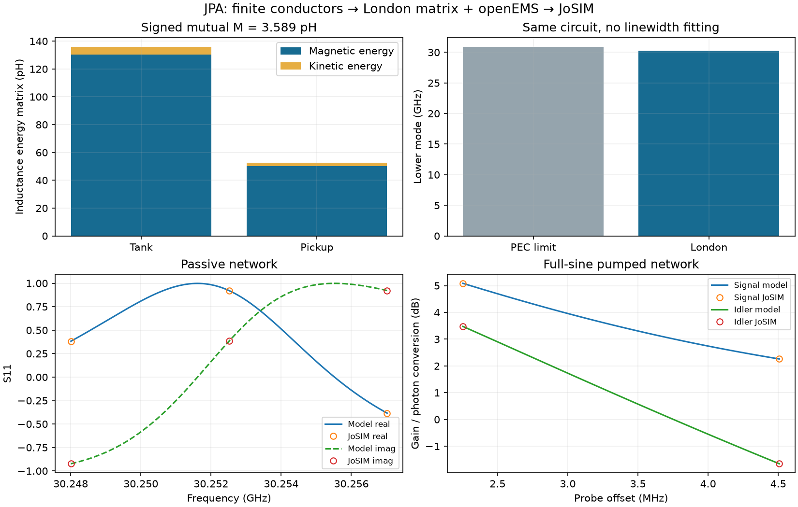

# London-network JPA validation

This benchmark tests a resonant Josephson parametric amplifier whose junction
and shunt capacitor are connected by finite metal, with a nearby inductive
pickup loop connected to the measurement port. It asks whether field-derived
capacitance and inductance predict the same passive reflection and pumped
signal/idler response as a physical JoSIM circuit. The passive field solvers
and the nonlinear circuit comparison validate different stages of that chain.

In the tables, a self inductance describes energy stored by one loop's current,
and mutual inductance describes coupling between the tank and pickup currents.
`L` is inductance, `C` is capacitance, and `Ic` is junction critical current.
`Cs`/`Cj` distinguish the shunt and junction capacitances. A picohenry (pH)
is `1e-12` H, a femtofarad (fF) is `1e-15` F, and a microampere is `1e-6` A.
`S11` is the complex reflected wave relative to the incident wave. Signal gain
is a power ratio; idler conversion is a photon-flux ratio. The
[workflow](magnetic-extraction.md) gives the circuit and reference planes,
and the [physical overview](physical-overview.md#how-to-read-the-results)
explains how those output quantities are interpreted.

Completed 2026-10-28. The [portable reference](../validation/magnetic-jpa-reference.json)
records native signed matrices, field convergence controls, kinetic-energy
checks and actual JoSIM response. The [workflow](magnetic-extraction.md)
explains reference planes, material inputs and reproduction.

## Extracted network

The benchmark is the illustrative single-JJ JPA with a finite rectangular M1
pickup loop: 40 um length, 10 um height, 8 um gap. All M1 (814 um²), M2
(238 um²), physical returns and both filled contacts enter the magnetic
current basis. Local 1 um square electrode patches are held fixed. The
inductive-component annotation is a connectivity marker, not the conductor
used for field extraction. KLayout checks the pickup geometry and annotated
connectivity independently. All seven example designs, including this pickup
topology, passed standalone geometry/connectivity and native KLayout Ruby DRC;
the [compact layout results](../validation/magnetic-layout-reference.json)
record versions, hashes and zero native violations.

The lossless operating-temperature London matrix is:

| Matrix entry | Total L (pH) | Kinetic energy (pH) | Positive-small-lambda PEC limit (pH) |
| --- | ---: | ---: | ---: |
| Tank self | 135.796485 | 5.288303 | 129.527932 |
| Pickup self | 52.559549 | 2.520321 | 49.689791 |
| Signed mutual | +3.588513 | +0.073835 | +3.479306 |

The 6.268553 pH tank SC-minus-PEC difference differs from the 5.288303 pH
kinetic energy. The former includes magnetic redistribution. The circuit uses
**135.796485 pH once**, along with pickup self and mutual; no extra Lk is added.

Primary discretization: 1.5 um bulk pitch, 0.25 um local basis, three
through-thickness filaments, 17,964 specified filaments, 1 MHz native solve.
The primary ran in 102.45 s under a 180 s / 4 GiB address-space cap. Independent
controls retain the same GDS and physical electrodes:

| Change | Maximum self change | Mutual change | Result |
| --- | ---: | ---: | --- |
| Bulk 1.5 → 2 um | 1.0824% | 1.5239% | Pass |
| Thickness count 3 → 1 | 0.0753% | 0.0673% | Pass |
| Local basis 0.25 → 0.5 um | 0.4981% | 2.1488% | Pass |

Self/mutual gates remain 2%/5%. An earlier 0.5 versus 1 um local-basis check
failed at **2.0558% self and 8.9923% mutual**. It was refined; those gates were
not relaxed. This is numerical convergence for the declared finite patches,
not uncertainty in the physical material parameters or footprint choice.

The fixed-basis 1 MHz/100 GHz matrix change is 3.81e-16, consistent with the
lossless London model. Positive-lambda PEC-limit refinement changes the matrix
by 1.09e-7 relative. Centered kinetic derivatives at `s=1±0.1` and `1±0.05`
differ by 0.01724%; the kinetic matrix has positive eigenvalues.

Separate native controls check a 20 um × 2 um × 40 nm uniform wire at lambda
450 nm: `mu0*lambda²*l/(w*t) = 63.617251 pH`, matching its variational kinetic
derivative. Doubling lambda gives a kinetic ratio 4.00000003. Reversing the
pickup port reverses mutual exactly at the reported precision. Increasing
the pickup gap from 8 to 20 um reduces coarse-control mutual from 4.051152 to
1.318328 pH. These isolated geometry/sign controls are not additional fine-mesh
device certifications.

## Back-annotation and actual JoSIM comparison

The same GDS's certified openEMS extraction gives Cs = 178.582195 fF. Actual
junction area and illustrative density give Ic = 20 uA and Cj = 240 fF.
External pickup termination is 50 ohm; Rinternal = 100 Mohm and Rjunction =
1 Gohm are explicit assumptions. Both capacitances and the complete signed
London matrix enter the five-state full-sine network and JoSIM RCSJ deck.
No damping, inductance or gain is fitted to the transient data.

Lower/upper circuit modes are 30.252515 / 85.562454 GHz. The lower-mode energy
decay rate is 56.629888 Mrad/s. Replacing only the London matrix with the PEC
limit gives 30.869708 GHz for the lower mode. The earlier capacitor-only
ideal-node model gave 60.642468 GHz: the new response retains the finite
interconnect and distinct JJ/capacitor nodes, rather than absorbing their
large inductance into an ideal parallel connection.

A deterministic model-only search selects the first stable weakly nonlinear
amplifying point in its declared grid: fp = 30.248008159 GHz,
Ppump = 4.7427474e-15 W, peak JJ phase 0.118111 rad. The periodic pump has
Floquet radius 0.999533805 and harmonic-balance residual 5.14e-17.
Three odd pump harmonics and five Floquet sidebands are used; four odd
harmonics and seven sidebands change signal/idler by less than 1.3e-6 dB.

| Probe (GHz) | Python signal gain | JoSIM signal gain | Signal error (dB) | Idler error (dB) |
| --- | ---: | ---: | ---: | ---: |
| 30.250261390 | 3.224674 | 3.224399 | -0.000370 | -0.000896 |
| 30.252514622 | 1.682837 | 1.683207 | +0.000955 | +0.002950 |

The maximum passive complex-S11 error is 0.000972. Acceptance gates are 0.02
for complex reflection and 0.25 dB for signal/idler, with 0.02 dB harmonic
refinement. Probe power is 1e-23 W per tone; pump-only subtraction isolates
the small response. Photon idler conversion includes its frequency ratio.

The final transient timestep is 2.5 fs, discarding the first 700 ns and fitting
700–1300 ns at 0.2 ps output intervals. The 600 ns acquisition resolves the
2.253 MHz minimum pump/probe/idler spacing; a shorter unresolved window was
rejected. Comparing 5 fs versus 2.5 fs changes signal/idler by at most
0.00275/0.00703 dB. Moving the 5 fs fit window to 1000–1600 ns changes them by
0.000279/0.000164 dB. These numerical sensitivities are below the acceptance
gates and are retained with the final results.

Native named float64 NPY output preserves the time axis. Six-digit CSV output
in this build produced repeated sub-picosecond timestamps beyond 1 us and
was rejected; timestamps were not reconstructed. Successful waveforms were
removed only after complete loading and measurement, while inputs, logs and
compact results remain locally available. Large traces are not committed.

The original bare signal/ground layout has a separate four-port-to-two-feed
reduction. A coarse native matrix and an explicit 5 kohm embedding validate
the `GalvanicJPA` circuit equations against JoSIM: signal errors below
0.00128 dB and idler errors below 0.00308 dB. This auxiliary case is **not**
a converged EM certificate for that bare geometry; the field convergence
certificate and sensitivity campaign above apply to the pickup benchmark.

## Provenance and limits

- Whiteley FastHenry 3.0wr, mod 031424; selected oriented-field build
  `3.0wr-031424-oriented-field1`, ELF SHA256
  `795e80818265ea346481f34edbfd849ad3848a9f577002388720cc8067191bef`.
- openEMS 0.37.0 / CSXCAD 0.7.0; the electric mesh/domain/duration checks and
  original source hashes are retained in the portable reference.
- JoSIM v2.7.0e0ed0f, source revision
  `0e0ed0fbf380399a4f53d9d8e55b33bb4c64cfc6`, phase mode, corrector 4;
  ELF SHA256 `5bbfde365428722b3c6a9f24904c38a30ac78e346a34a68fcc553bc0e4fe8174`.

`tools/capture_magnetic_jpa.py` produces the compact reference and figure
from completed raw cases. Compact reports retain parent hashes and raw native
signed matrices, but are not themselves reusable sealed extraction artifacts.
Ordinary tests recompute matrix reduction, energy accounting and circuit
response from the reference; CI does not claim to rerun native solvers.

The result validates the classical response of the extracted hybrid circuit,
not fabricated-device performance, noise, radiation or all electric stray
coupling. Materials and loss assumptions remain illustrative. See the
[workflow scope](magnetic-extraction.md#scope) before transferring it to
another process or amplifier family.
