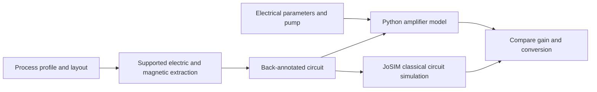

# What is being simulated?

This page supplies the physical background. For the engineering sequence and
software needed to carry it out, use the [design cycle](design-workflow.md)
and [tools guide](tools-and-setup.md). The main loop is electrical simulation,
candidate layout, geometry checking, supported extraction, circuit comparison
and revision until the chosen targets are met.

TWPA Sim models superconducting microwave **parametric amplifiers**. These
devices use a strong microwave drive, called the **pump**, to transfer energy
into a much weaker microwave **signal**. A nonlinear inductance makes this
energy transfer possible. The calculation predicts how much the signal grows,
what other frequencies appear, and how loss and quantum fluctuations affect
the amplified output.

The intended use is to explore amplifier circuits and compare modeling
approximations before committing to a physical design. For example: Will a
proposed transmission line amplify a 900 MHz signal when pumped at 1 GHz?
Will its internal losses make the added noise appreciably worse than the
quantum limit? Will metal interconnect inductance shift the resonance of a
layout-derived Josephson amplifier? Each question needs a different level of
model detail, as explained below.

The repository contains **illustrative circuits and numerical benchmarks**.
A parameter set that runs successfully is not, by itself, a fabrication-ready
design or a reproduction of a device in the literature. The device guides
identify the physical assumptions and the published work behind each model.

## Pump, signal and idler

The signal is the tone whose information we want to amplify. The pump supplies
the energy. The nonlinear circuit also couples the signal to another frequency,
called the **idler**. In the usual amplifier calculation, a signal is applied
at the input while no coherent idler is deliberately injected. The idler still
has vacuum fluctuations, and possibly thermal fluctuations, which matter for
the output noise.

We write the pump, signal and idler frequencies as `f_p`, `f_s` and `f_i`.
All three are ordinary frequencies in hertz. Their relation depends on the
mixing process:

| Process | Energy-conserving frequency relation | Example |
| --- | --- | --- |
| Three-wave mixing, abbreviated 3WM | `f_p = f_s + f_i` | A 1 GHz pump couples a 0.45 GHz signal to a 0.55 GHz idler |
| Four-wave mixing, abbreviated 4WM | `2*f_p = f_s + f_i` | A 1 GHz pump couples a 0.9 GHz signal to a 1.1 GHz idler |

“Three” and “four” count the interacting waves, with the pump counted twice
in the 4WM process. These names do not count junctions or physical ports.
A model can also generate pump harmonics and further mixing products; the
table names the principal signal–idler interaction.

**Degenerate** operation means that signal and idler coincide in frequency.
The amplifier can then amplify one field quadrature and deamplify the other.
A quadrature is one of the two phase components of an oscillation, analogous
to its cosine and sine components. Distinct signal/idler operation is often
called nondegenerate. The resonant JPA APIs support the appropriate
quadrature calculation at degeneracy; the distributed examples use distinct
signal and idler frequencies.

## Resonant amplifiers and traveling-wave amplifiers

A **Josephson parametric amplifier**, or JPA, can store microwave energy in a
resonator made from a nonlinear inductance and a capacitance. The pump changes
the response of this resonator. The examples drive it through one port and
calculate the amplified signal **reflected** back out of that port. Its
resonance and damping determine the frequency range over which gain occurs.
[Eichler and Wallraff](references.md#eichler2014) discuss this relationship
between resonator nonlinearity, gain, bandwidth and dynamic range.

A **traveling-wave parametric amplifier**, or TWPA, distributes the nonlinear
interaction along a transmission line. The pump and signal propagate through
many repeated circuit sections, called **cells**, and the desired signal
leaves the far end. Gain is therefore usually a **transmission** measurement.
Amplification generated by successive cells adds efficiently only when the
waves maintain the appropriate relative phase. This is **phase matching**.

Propagation velocity generally depends on frequency, an effect called
**dispersion**. Both the passive circuit and the pump's nonlinear phase shift
affect phase matching. Periodic loading or added resonators can modify
dispersion; they are physical circuit elements rather than arbitrary gain
corrections. [O'Brien et al.](references.md#obrien2014) give the resonant
phase-matching approach used as background for the 4WM Josephson chain.

## Where the nonlinearity comes from

### Kinetic-inductance transmission lines

In a superconducting film, moving charge carriers store kinetic energy as
well as magnetic-field energy. The resulting **kinetic inductance** can depend
on current. The KIT models represent a line as a ladder of series inductances
and shunt capacitances. A strong pump changes the effective inductance and
couples waves. A direct-current bias supplies the asymmetry needed for the
3WM interaction used in the main KIT examples.

KIT means **kinetic-inductance traveling-wave**. The material mechanism and
the use of a biased artificial transmission line are discussed by
[Eom et al.](references.md#eom2012) and
[Malnou et al.](references.md#malnou2021). The package's cell values and loss
parameters must still be calibrated for a particular film and layout.

### Josephson junctions

A Josephson junction, abbreviated **JJ**, is described by a current–phase
relation. For the ideal sinusoidal element used here,

`I = I_c sin(delta)`.

Here `I` is the supercurrent in amperes, `I_c` is the junction's critical
current in amperes, and `delta` is the superconducting phase difference in
radians. Near zero phase, its small-signal inductance is
`L_J = phi_bar/I_c`, where `phi_bar = Phi_0/(2*pi)` and `Phi_0 = h/(2*e)` is
the superconducting flux quantum. The constants `h` and `e` are Planck's
constant and the positive elementary charge. `phi_bar` has units of webers;
the code calls it `PHIBAR`.

The Josephson traveling-wave amplifier, abbreviated **JTWPA**, replaces the
nonlinear film inductance with junctions or junction loops. The unbiased
junction chain supports 4WM. For 3WM, an applied magnetic flux biases an
asymmetric circuit potential. The supported elements are the one-junction
**rf-SQUID** (radio-frequency superconducting quantum interference device)
and the **SNAIL** (superconducting nonlinear asymmetric inductive element).
Their circuit constructions and potentials follow the classes described by
[Zorin](references.md#zorin2016) and
[Frattini et al.](references.md#frattini2017).

The physical circuit models also include junction capacitance and a loss
resistance. This is the **RCSJ** model: a resistively and capacitively shunted
Josephson junction. It can describe capacitive dynamics and resistive damping
that an ideal nonlinear inductance alone would omit.

## Which level of simulation should I use?

The repository offers related levels of description, not a single automatic
pipeline for every family:

| Level | Inputs | What is solved | Main output |
| --- | --- | --- | --- |
| Effective resonant JPA | Resonance, damping rates, nonlinear coefficient and pump | A driven mode and its fluctuations | Reflection gain, stable pump branches, noise and quadrature response |
| KIT propagation | Electrical ladder, current nonlinearity, bias and optional dielectric-loss model | Passive propagation and coupled traveling-wave amplitudes | Dispersion, forward gain, depletion and bath noise |
| Finite Josephson circuit | Individual junction/loop parameters, cell count and physical terminations | Coupled circuit equations at retained frequencies | Reflection, transmission, harmonics, depletion and Gaussian noise |
| Layout and field extraction | Fabrication profile, drawn geometry and material stack | Electric and magnetic fields for supported structures | Capacitance and signed inductance matrices for circuit back-annotation |
| JoSIM transient comparison | A physical circuit netlist and time-dependent drives | Classical circuit evolution in time | Voltage/phase traces from which gain and conversion are measured |

**Back-annotation** means replacing assumed circuit parameters with values
extracted from geometry. The dedicated single-JJ JPA benchmark combines
shunt-capacitor extraction with finite interconnect, return and pickup-loop
inductances. The [general adapter](layout-backannotation.md) extends finite
terminal circuits to SQUID/4WM/rf-SQUID/SNAIL layouts. KIT uses an explicitly
calibrated periodic reduction. Each route has its own
[field/circuit acceptance evidence](layout-network-validation.md); an
extracted classical circuit does not automatically acquire the reduced
models' quantum-noise or dynamical-stability guarantees.

This diagram shows how the descriptions exchange information. The
[design-cycle diagram](design-workflow.md) adds the pass/fail decisions and
revision loops; it also identifies which feedback paths are currently
implemented for each device family.

Choose an effective mode when resonance and damping are already known and you
want fast operating-point sweeps. Choose a finite circuit when end reflections,
junction capacitance, loop physics or generated harmonics matter. Choose field
extraction when the uncertainty is in the physical capacitance or interconnect
inductance. Use JoSIM to check classical circuit predictions independently.

## How to read the results

**Power gain** is `G = P_signal,out / P_signal,in`, where the two `P` values
are signal powers in watts at the specified ports. `G=1` means unity gain,
and `G=10` means tenfold signal power. The decibel value is
`G_dB = 10*log10(G)`, so these examples correspond to 0 dB and 10 dB.
A resonant JPA and a TWPA use different output ports, as explained above.

**Idler conversion** in the Josephson APIs is a photon-flux ratio. Photon flux
is power divided by photon energy `h*f`. A reported conversion of one means
one outgoing idler photon per incoming signal photon; it does not generally
mean equal powers because the frequencies can differ. Multiply the photon
ratio by `f_i/f_s` to obtain the idler-to-input-signal power ratio.

**Pump depletion** means that energy transferred to generated waves changes
the pump itself. An undepleted small-signal calculation first solves the pump,
then asks how an infinitesimal signal responds. A depleted classical
calculation solves the finite pump and signal together. **Compression** is
the reduction of gain as signal power increases; the 1 dB compression point
is where gain falls 1 dB below its weak-signal reference.

**Added noise** describes output fluctuations referred back to the signal
input by dividing by gain and subtracting the original signal-input noise.
These models use symmetrized photon units, in which vacuum noise is one half
quantum. For a phase-preserving amplifier of power gain `G>1`, the ideal
vacuum lower bound is `(1 - 1/G)/2` added quanta. It approaches one half only
at large gain. A phase-sensitive, degenerate amplifier needs a quadrature
description instead. See [Caves](references.md#caves1982) and
[Caves et al.](references.md#caves2012) for the quantum limits.

An internal resistor both dissipates energy and supplies fluctuating current.
Its associated **bath** is the environment responsible for those fluctuations.
Even a zero-temperature bath contributes vacuum noise. The Gaussian noise
solvers propagate the means and second moments of small quantum fluctuations
about a classical operating point; they do not solve arbitrary quantum
switching or non-Gaussian states. Classical JoSIM traces check gain and mixing,
while quantum identities and analytic limits check the noise calculation.

## A useful reading and simulation order

Use the [design cycle](design-workflow.md) for the overall process and the
[HOWTO](../HOWTO.md) for its small electrical examples. Before applying a
pump, inspect the passive circuit's transmission or reflection. Next choose
supported pump, signal and idler frequencies and solve a weak-signal response.
Add loss and noise only after understanding that classical response. Finally,
increase signal power, refine numerical settings and, where supported, compare
with a physical JoSIM circuit or layout-derived parameters.

The [symbol glossary](symbols.md) is a lookup aid. Each device guide also
defines its local notation because the same letter can mean different things
in different models. The [numerical-method guide](numerical-methods.md)
explains convergence and stability diagnostics, and the
[conventions guide](conventions.md) records exact normalization and units.
