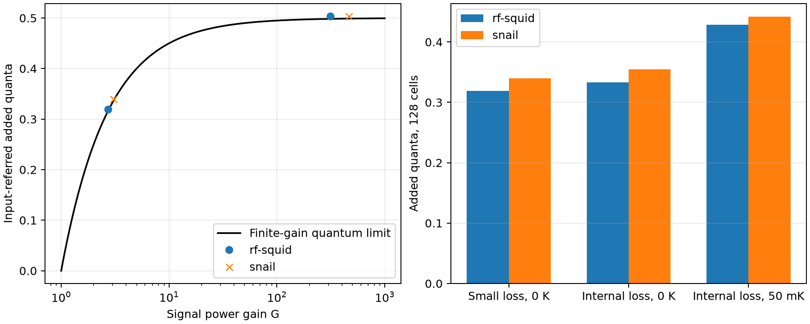

# rf-SQUID/SNAIL 3WM validation

These benchmarks test finite transmission lines made from magnetically biased
Josephson loops. The bias creates an asymmetric potential, allowing a pump
to couple signal and idler by three-wave mixing. The
[3WM guide](three-wave-josephson.md) explains the two loop constructions,
their equations and the Zorin/Frattini/Roudsari references.

Here `fp`, `fs` and `fi` label pump, signal and idler frequencies; `kp`, `ks`
and `ki` label their phase advance per cell. The relation `kp=ks+ki` is linear
phase matching, while `fp=fs+fi` is energy conservation. `Ic` is a physical
junction critical current; `c2` is normalized potential curvature, so `Ic*c2`
is a derived linear scale. Flux is quoted relative to the superconducting
flux quantum. RCSJ means resistively and capacitively shunted junction.

Classical response is compared with physical JoSIM RCSJ circuits. Quantum
noise is checked separately against commutator identities, thermal
fluctuation-dissipation, covariance uncertainty and finite-gain quantum
limits. JoSIM's classical resistor noise is not used as a vacuum reference.
These are synthetic circuit benchmarks, not fabricated-device calibrations
or reproductions of a published gain curve.

## Physical circuit parameters

The amplifying benchmarks contain 128 cells with linear inductance 2.5 nH,
ground capacitance 1 pF, effective junction capacitance 5 pF and 50-ohm ports.
They use a capacitively coupled resonator at each node: coupling 0.2 pF,
resonator capacitance 1 pF, inductance 22.6108484 nH and resistance 1 Gohm.
Its bare resonance is 1.05842893 GHz. These values match linear
kp=ks+ki at fp=1 GHz, fs=0.45 GHz and fi=0.55 GHz, while the unwanted
sum-frequency bands are above the ladder cutoff. They were selected from
the circuit dispersion, without fitting to pumped JoSIM gain.

The rf-SQUID uses Ic=0.0841575804 uA, loop inductance 3.12847377 nH,
beta_L=0.8 and flux 0.32 Phi0. Its junction capacitance is 5 pF.
The SNAIL has three large junctions, alpha=0.3 and flux 0.35 Phi0.
Each large junction has Ic=0.333504613 uA and C=7.89473684 pF; the small
junction has alpha times these values and 1/alpha times the resistance.
The physical SNAIL circuit uses a 0.1 pH geometric loop inductor, whereas
the reduced potential takes the zero-geometric-inductance limit.

Each JoSIM circuit contains the actual junctions: 128 in the rf-SQUID
chain and 512 in the SNAIL chain. Loop inductors are coupled to explicit
bias coils carrying a prescribed current. A smooth 100 ns flux ramp and
30 ns exponential RF turn-on precede acquisition. End shunts and resonators
have half the interior admittance. JJ capacitance appears once in the RCSJ
model. No classical noise source is enabled.

Available pump power is 1.40370726e-14 W. Weak-probe power is 1e-6 times
pump power. The depleted SNAIL case uses probe/pump power 0.1. Nearly
lossless junction resistance is 1 Gohm. Lossy cases use 20 kohm per
rf-SQUID/large SNAIL junction and 100 kohm ground resistance; SNAIL's small
junction resistance is 66.6667 kohm. Resonator resistance remains 1 Gohm.

## Classical JoSIM comparisons

Incident/reflected waves are extracted from Thevenin source and input-node
voltages, not from a raw output/source voltage ratio. A joint coherent fit
extracts signal, idler and pump harmonics. Signal/idler fits subtract a
pump-only trajectory; pump transmission uses the full driven trajectory.
Interior-node recurrence also measures the passive Bloch wavenumber.

The model retains the exact element potential, pump-induced DC shift,
harmonics through 3*fp and one signal-offset sideband pair. The depleted
case retains three sideband pairs and generated difference frequencies.
Quadrature is 24 points per torus phase.

| Circuit | JoSIM signal gain | Model gain | JoSIM idler conversion | Model conversion | Signal / idler error (dB) |
| --- | ---: | ---: | ---: | ---: | ---: |
| rf-SQUID 128, small loss | 2.708635 | 2.709754 | 1.713900 | 1.715032 | -0.00179 / -0.00287 |
| SNAIL 128, small loss | 3.047055 | 3.048125 | 2.052619 | 2.053669 | -0.00153 / -0.00222 |
| rf-SQUID 128, internal loss | 2.358361 | 2.365967 | 1.427237 | 1.435465 | -0.01398 / -0.02497 |
| SNAIL 128, internal loss and depletion | 2.375850 | 2.386224 | 1.430469 | 1.441258 | -0.01892 / -0.03263 |

Gain is a signal power ratio; conversion is a photon-flux ratio including
fs/fi. Errors are 10*log10(JoSIM/model). The nearly lossless mean signal/idler
agreement is below 0.003 dB; all selected cases are within 0.033 dB.
For depleted SNAIL, pump transmission is 0.400995 versus 0.407195 in the
model (-0.06663 dB). This comparison includes both resistive attenuation
and conversion-induced pump depletion.

The measured middle-element DC phases agree within 1.02e-4 rad across these
cases, confirming that pump-induced rectification is part of the solution.
For the finer nearly lossless runs the errors are 2.15e-5 rad (rf-SQUID)
and 9.47e-6 rad (SNAIL). Across all selected passive runs the largest complex
S21 error is below 0.0027, S11 error below 0.013 and wavenumber error below
0.00064 rad/cell. The lossy cases use a coarser simulation step.

## Numerical and model-domain checks

Nearly lossless final runs use 0.5 ps internal steps and a 1.0–1.2 us
acquisition window. The initial comparison used 1 ps and 0.4–0.6 us.
Output sampling is 10 ps. Lossy/depleted runs use the latter settings.
The joint step/settling refinement changes signal/idler results by less than
0.07 dB; the per-execution build details below are also relevant to this
comparison.

Splitting final records into equal early/late windows gives these changes:

| Circuit | Signal (dB) | Idler (dB) | Pump (dB) |
| --- | ---: | ---: | ---: |
| rf-SQUID, small loss | -0.00192 | -0.00451 | +0.01019 |
| SNAIL, small loss | -0.00383 | -0.00764 | +0.05998 |
| rf-SQUID, internal loss | +0.00358 | +0.00726 | +0.00457 |
| SNAIL, internal loss and depletion | +0.01445 | +0.02463 | +0.16135 |

The resonators retain startup ringing. Window sensitivity, particularly
the depleted pump's 0.16 dB change, is larger than some mean circuit/model
differences. The table digits are regression values, not uncertainty claims
at the 0.001 dB level. Longer windows/settling should be used when pump
transmission needs higher precision.

Increasing the depleted model from three to four pump harmonics changes
gain/conversion by less than 1e-6 dB. Increasing offset sidebands from three
to four changes conversion by 2.75e-6 dB. Thus model spectral truncation is
much smaller than the transient sensitivities at this point.

An independent 16-cell SNAIL loop-size check halves geometric inductance
from 0.1 to 0.05 pH. The equilibrium discrepancy falls from -2.37603e-5 to
-1.18691e-5 rad, verifying approach to the reduced potential. Passive S21
errors remain about 0.00024, dominated by other numerical effects. This
does not validate the reduction for a large-loop or unequal-junction SNAIL.

## Quantum noise and internal loss

Noise uses the same self-consistent classical pump and finite-circuit
Jacobian. Independent resistor baths include vacuum and thermal fluctuations
for the junctions, ground resistors and resonators. Both external ports are
included at each retained Floquet sideband. The 128-cell operating points
match those used for the circuit comparisons; the high-gain 384-cell
extensions below have not separately been simulated in JoSIM.

| Circuit calculation | Gain (dB) | Added quanta | Finite-gain limit | Excess quanta |
| --- | ---: | ---: | ---: | ---: |
| rf-SQUID 128, small loss | 4.3293 | 0.319178 | 0.315481 | 0.003696 |
| SNAIL 128, small loss | 4.8403 | 0.339856 | 0.335965 | 0.003892 |
| rf-SQUID 384, small loss | 24.9529 | 0.503682 | 0.498402 | 0.005281 |
| SNAIL 384, small loss | 26.6595 | 0.503806 | 0.498921 | 0.004885 |
| rf-SQUID 128, loss, 0 K | 3.7401 | 0.333445 | 0.288670 | 0.044775 |
| rf-SQUID 128, loss, 50 mK | 3.7401 | 0.428714 | 0.288670 | 0.140044 |
| SNAIL 128, loss, 0 K | 4.2954 | 0.354703 | 0.314036 | 0.040666 |
| SNAIL 128, loss, 50 mK | 4.2954 | 0.441827 | 0.314036 | 0.127791 |

The stated temperatures apply to junction and ground baths; external ports
and the high-resistance resonators remain at 0 K in this table. Separate
equilibrium tests heat every bath, including resonators. Noise values are
small-signal pump-only calculations, including in the lossy SNAIL row whose
separate classical probe comparison uses depletion.



The correct finite-gain amplifier bound is (1-1/G)/2, approaching 1/2 at
high gain. Extra reflected/conversion channels account for the small excess
in the nearly lossless circuits. Resistive loss raises the excess, and
warming the dissipative circuit raises noise further. No transfer or noise
renormalization is applied to obtain these results.

Both output commutator identities hold within 3.1e-12 across the larger
benchmarks, and full covariance uncertainty is satisfied to numerical
precision. Common-temperature passive equilibrium agrees with the Bose
occupation to better than 4e-14 quanta. Increasing pump harmonics from three
to four and quadrature from 24 to 32 changes 128-cell added noise by less
than 2e-8 quanta. These are local resolution checks, not universal error bars.

Eight dedicated analytic tests cover equilibrium/flux symmetry, potential
derivatives, effective RC normalization, DC rectification and its Jacobian,
passive ABCD limits, power conservation, 3WM Manley–Rowe identities, photon
normalization, quantum commutators, thermal equilibrium and all internal
bath families. The existing ideal-amplifier tests additionally verify the
finite/high-gain half-quantum limit and cold attenuator limit. Stored circuit
regressions recompute the model against actual measured JoSIM responses.

## Reproduction and provenance

```powershell
python tools/validate_three_wave_josim.py --kind snail --engineered `
  --cells 128 --pump-ratio .18 --step 5e-13 --stop 1.2e-6 --start 1e-6 `
  --executable /path/to/josim-cli --wsl Ubuntu --corrector 4 `
  --output validation/runs/snail-example
python tools/validate_three_wave_noise.py --output validation/runs/3wm-noise.json `
  --plot validation/runs/3wm-noise.png
```

Use `--kind rf-squid` for rf-SQUID. For the lossy benchmark add
`--junction-resistance 20000 --ground-resistance 100000 --temperature .05`.
The depleted case also uses `--probe-ratio .1 --depleted --sidebands 3`.
`check_three_wave_geometry.py` checks the physical small-loop limit;
`check_three_wave_convergence.py` refits half-windows and recomputes depleted
spectral refinements. Omit WSL for native execution; request a corrector only
if the installed simulator supports it. Output directories must be fresh.

The [classical fixture](../tests/fixtures/josim_three_wave.json) stores
measurements, physical circuit parameters, controls, execution banners and
SHA-256 hashes of netlists and CSVs. `capture_three_wave_validation.py`
verifies successful runs, expected physical junction counts and matching
pump/probe execution versions before freezing them. Raw evidence is retained
locally under ignored `validation/runs/three-wave/`. The generated
[quantum record](data/three-wave-quantum.json) is explicitly identified as
a model consistency calculation and contains source hashes.

JoSIM used phase analysis and enhanced corrector 4. The executable reported
v2.7.0e0ed0f, with builds dated 2026-10-27 16:26:59 and 17:34:54. It was
rebuilt externally during validation. The backend's cached initial version
can therefore differ from a run's actual stdout banner; both are preserved.
The final rf-SQUID pump baseline was replaced using a frozen executable
matching the probe's reported build. Its original baseline/summary are
retained for audit, and the replacement executable hash is recorded.
Final pump/probe execution banners match for each selected benchmark.
Passive runs may use the earlier build, and a clean source tree is not
attested. Treat coarse-to-fine differences as combined step, settling and
build sensitivity. Pin the executable before running a new strict numerical
convergence study.

The quantum calculation assumes Gaussian fluctuations about a stable
classical pump state; dynamical stability is not certified by the algebraic
solve. It omits quantum-induced pump depletion, phase slips and technical
flux noise. See the [model guide](three-wave-josephson.md) for the supported
branch, geometric-loop, nondegeneracy and pump-only noise restrictions.
